This document presents a modular architecture for LLM agents: the components an agent consists of, the interfaces between them and how they work together.

The goal is to build agents from ready-made blocks. A new agent is made by replacing, adding or removing components. Swapping a hosted model for a local one, giving an agent a new tool or putting a permission check in front of its tools must each be a change to one component, with the rest of the agent untouched.

Only the essential components are covered here. Each of them is developed in more detail in separate documents.

The architecture is technology agnostic. Interfaces are written in Python only as an example notation, and any language with types and interfaces can express them. Each interface is followed by a small fake example. Every code block runs on its own when pasted into a Python console: the definitions it needs from earlier sections are included in a folded part at its top.

## 1. The core idea

An agent is a model run in a loop.

The model reads the conversation so far and decides what to do next: answer, or ask for a tool to be used. The harness runs the loop: it sends the conversation to the model, executes the tools the model asks for, adds the results to the conversation and asks the model again. The tools are what the agent can do beyond producing text: run commands, read files, call services, operate devices.

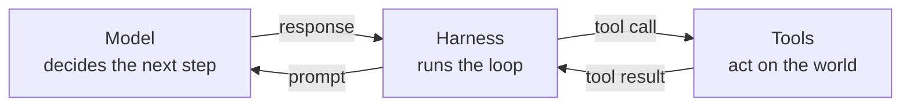

*Graph 1: The three components of an agent and the messages they exchange.*

The three components exchange four kinds of messages:

- A prompt, sent by the harness to the model: everything the model must know to decide the next step.
- A response, returned by the model: text, tool calls, or both.
- A tool call, passed by the harness to a tool: the name of the tool and its input, as requested by the model.
- A tool result, returned by the tool: the output, or an error.

A typical run takes several rounds:

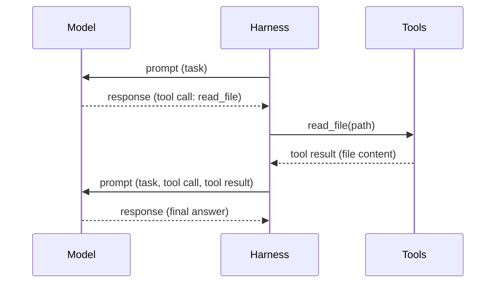

*Graph 2: A run with one tool call, in two rounds between the harness and the model.*

The model only asks for actions, and the harness carries them out. This split is the basis of the whole architecture: the next sections define the data that flows on the arrows, then each component in turn.

## 2. The data between components

Components exchange data only: values that carry no behaviour and can be serialized, for example to JSON. No component passes objects with methods or references to its internals to another component. This keeps components independent and makes every exchange possible to log, store and replay.

### Conversation

The conversation is a list of messages. Each message has a role, `user` for what comes into the agent and `assistant` for what the model produced, and a list of content blocks. A content block is one piece of content:

- Text.
- A tool call: an id, the tool name and the input.
- A tool result: the id of the call it answers, the output and an error flag.
- Thinking: the model's reasoning, if the model produces it.

```python
from dataclasses import dataclass
from typing import Literal

@dataclass
class Text:
    text: str

@dataclass
class ToolCall:
    id: str
    name: str
    input: dict

@dataclass
class ToolResult:
    call_id: str
    content: list[Text]
    is_error: bool = False

@dataclass
class Thinking:
    text: str

ContentBlock = Text | ToolCall | ToolResult | Thinking

@dataclass
class Message:
    role: Literal["user", "assistant"]
    content: list[ContentBlock]

# Example: the run from Graph 2 as a conversation
conversation = [
    Message("user", [Text("How many lines does notes.txt have?")]),
    Message("assistant", [
        ToolCall(id="c1", name="read_file", input={"path": "notes.txt"}),
    ]),
    Message("user", [
        ToolResult(call_id="c1", content=[Text("first\nsecond\nthird")]),
    ]),
    Message("assistant", [Text("notes.txt has 3 lines.")]),
]
for message in conversation:
    print(message)
```


Tool results are sent in `user` messages, because they come into the agent from outside the model.

### Prompt and response

A prompt is what the model receives on one call: the system prompt (the standing instructions that define the agent), the conversation, and the definitions of the tools the model may call. A tool definition tells the model what a tool does and what input it takes.

```python
# region Needed from earlier sections
from dataclasses import dataclass
from typing import Literal

@dataclass
class Text:
    text: str

@dataclass
class ToolCall:
    id: str
    name: str
    input: dict

@dataclass
class ToolResult:
    call_id: str
    content: list[Text]
    is_error: bool = False

@dataclass
class Thinking:
    text: str

ContentBlock = Text | ToolCall | ToolResult | Thinking

@dataclass
class Message:
    role: Literal["user", "assistant"]
    content: list[ContentBlock]

conversation = [
    Message("user", [Text("How many lines does notes.txt have?")]),
    Message("assistant", [
        ToolCall(id="c1", name="read_file", input={"path": "notes.txt"}),
    ]),
    Message("user", [
        ToolResult(call_id="c1", content=[Text("first\nsecond\nthird")]),
    ]),
    Message("assistant", [Text("notes.txt has 3 lines.")]),
]
# endregion

from dataclasses import dataclass

@dataclass
class ToolDefinition:
    name: str
    description: str
    input_schema: dict  # JSON Schema of the input

@dataclass
class Prompt:
    system: str
    messages: list[Message]
    tools: list[ToolDefinition]

# Example: the first prompt of the run, with one tool
read_file = ToolDefinition(
    name="read_file",
    description="Read a text file and return its content.",
    input_schema={
        "type": "object",
        "properties": {"path": {"type": "string"}},
        "required": ["path"],
    },
)
prompt = Prompt(
    system="You are a helpful assistant.",
    messages=conversation[:1],
    tools=[read_file],
)
print(prompt)
```

A response is what the model returns: new content blocks, the reason it stopped and what the call cost.

```python
# region Needed from earlier sections
from dataclasses import dataclass

@dataclass
class Text:
    text: str

@dataclass
class ToolCall:
    id: str
    name: str
    input: dict

@dataclass
class ToolResult:
    call_id: str
    content: list[Text]
    is_error: bool = False

@dataclass
class Thinking:
    text: str

ContentBlock = Text | ToolCall | ToolResult | Thinking
# endregion

from dataclasses import dataclass
from typing import Literal

StopReason = Literal[
    "end_turn",    # the model has finished
    "tool_use",    # the model asks for tool calls
    "max_tokens",  # the model was cut off at the output limit
    "refusal",     # the model declined to continue
]

@dataclass
class Usage:
    input_tokens: int
    output_tokens: int
    cost: float
    seconds: float

@dataclass
class Response:
    content: list[ContentBlock]
    stop_reason: StopReason
    usage: Usage

# Example: the model asks for a tool call
response = Response(
    content=[ToolCall(id="c1", name="read_file", input={"path": "notes.txt"})],
    stop_reason="tool_use",
    usage=Usage(input_tokens=120, output_tokens=25, cost=0.0004, seconds=0.8),
)
print(response)
```

## 3. Model

The model is a stateless function from a prompt to a response. It keeps no memory between calls, so everything it needs to know must be in the prompt.

The model can run in different places:

- On a vendor's servers, accessed through a hosted API.
- On an inference server in the local network.
- In a separate process on the same machine.
- Inside the agent's own process, loaded as a library.

The rest of the agent does not know where the model runs. It only sees this interface:

```python
# region Needed from earlier sections
from dataclasses import dataclass
from typing import Literal

@dataclass
class Text:
    text: str

@dataclass
class ToolCall:
    id: str
    name: str
    input: dict

@dataclass
class ToolResult:
    call_id: str
    content: list[Text]
    is_error: bool = False

@dataclass
class Thinking:
    text: str

ContentBlock = Text | ToolCall | ToolResult | Thinking

@dataclass
class Message:
    role: Literal["user", "assistant"]
    content: list[ContentBlock]

conversation = [
    Message("user", [Text("How many lines does notes.txt have?")]),
    Message("assistant", [
        ToolCall(id="c1", name="read_file", input={"path": "notes.txt"}),
    ]),
    Message("user", [
        ToolResult(call_id="c1", content=[Text("first\nsecond\nthird")]),
    ]),
    Message("assistant", [Text("notes.txt has 3 lines.")]),
]

@dataclass
class ToolDefinition:
    name: str
    description: str
    input_schema: dict  # JSON Schema of the input

@dataclass
class Prompt:
    system: str
    messages: list[Message]
    tools: list[ToolDefinition]

read_file = ToolDefinition(
    name="read_file",
    description="Read a text file and return its content.",
    input_schema={
        "type": "object",
        "properties": {"path": {"type": "string"}},
        "required": ["path"],
    },
)

prompt = Prompt(
    system="You are a helpful assistant.",
    messages=conversation[:1],
    tools=[read_file],
)

StopReason = Literal[
    "end_turn",    # the model has finished
    "tool_use",    # the model asks for tool calls
    "max_tokens",  # the model was cut off at the output limit
    "refusal",     # the model declined to continue
]

@dataclass
class Usage:
    input_tokens: int
    output_tokens: int
    cost: float
    seconds: float

@dataclass
class Response:
    content: list[ContentBlock]
    stop_reason: StopReason
    usage: Usage
# endregion

import asyncio
from abc import ABC, abstractmethod
from collections.abc import AsyncIterator
from dataclasses import dataclass

@dataclass
class Capabilities:
    context_window: int
    tool_calling: bool

# Pieces of text as they are produced, then the whole response.
ModelEvent = str | Response

class Model(ABC):
    @abstractmethod
    async def complete(self, prompt: Prompt) -> Response:
        """Send the prompt and wait for the whole response."""

    @abstractmethod
    def stream(self, prompt: Prompt) -> AsyncIterator[ModelEvent]:
        """Yield the response as it is produced, then the whole response."""

    @abstractmethod
    def capabilities(self) -> Capabilities:
        """What the model supports: context window, tools, images."""

# Example: a fake model that always gives the same answer
class FakeModel(Model):
    async def complete(self, prompt):
        text = Text("Hi, I am a fake model.")
        return Response([text], "end_turn", Usage(40, 10, 0.0, 0.1))

    async def stream(self, prompt):
        yield await self.complete(prompt)

    def capabilities(self):
        return Capabilities(context_window=8_000, tool_calling=True)

print(asyncio.run(FakeModel().complete(prompt)))
```

Behind the interface, the model is made of three replaceable parts:

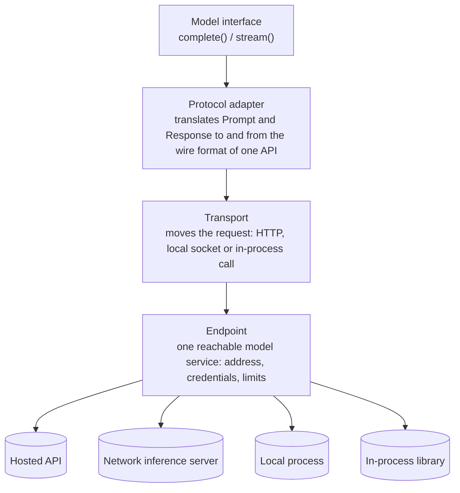

*Graph 3: The parts behind the model interface and the places where a model can run.*

Moving an agent to a different model or a different place where the model runs changes only these parts.

### Protocol adapter

A protocol adapter converts between the common data of section 2 and the wire format of one API. It is a pure data-to-data conversion: it performs no I/O and holds no credentials, so it can be tested without network access. Supporting another API requires another adapter; the rest of the agent is unchanged.

The example implements the adapter for the Anthropic Messages API. It encodes the prompt from the Prompt and response section and decodes a sample response body, so it runs without an API key.

```python
# region Needed from earlier sections
from dataclasses import dataclass
from typing import Literal

@dataclass
class Text:
    text: str

@dataclass
class ToolCall:
    id: str
    name: str
    input: dict

@dataclass
class ToolResult:
    call_id: str
    content: list[Text]
    is_error: bool = False

@dataclass
class Thinking:
    text: str

ContentBlock = Text | ToolCall | ToolResult | Thinking

@dataclass
class Message:
    role: Literal["user", "assistant"]
    content: list[ContentBlock]

conversation = [
    Message("user", [Text("How many lines does notes.txt have?")]),
    Message("assistant", [
        ToolCall(id="c1", name="read_file", input={"path": "notes.txt"}),
    ]),
    Message("user", [
        ToolResult(call_id="c1", content=[Text("first\nsecond\nthird")]),
    ]),
    Message("assistant", [Text("notes.txt has 3 lines.")]),
]

@dataclass
class ToolDefinition:
    name: str
    description: str
    input_schema: dict  # JSON Schema of the input

@dataclass
class Prompt:
    system: str
    messages: list[Message]
    tools: list[ToolDefinition]

read_file = ToolDefinition(
    name="read_file",
    description="Read a text file and return its content.",
    input_schema={
        "type": "object",
        "properties": {"path": {"type": "string"}},
        "required": ["path"],
    },
)

prompt = Prompt(
    system="You are a helpful assistant.",
    messages=conversation[:1],
    tools=[read_file],
)

StopReason = Literal[
    "end_turn",    # the model has finished
    "tool_use",    # the model asks for tool calls
    "max_tokens",  # the model was cut off at the output limit
    "refusal",     # the model declined to continue
]

@dataclass
class Usage:
    input_tokens: int
    output_tokens: int
    cost: float
    seconds: float

@dataclass
class Response:
    content: list[ContentBlock]
    stop_reason: StopReason
    usage: Usage
# endregion

import json
from abc import ABC, abstractmethod

class ProtocolAdapter(ABC):
    @abstractmethod
    def encode(self, model: str, prompt: Prompt) -> dict:
        """Convert the prompt to a request body of one API."""

    @abstractmethod
    def decode(self, body: dict) -> Response:
        """Convert a response body of the API to a response."""

# Example: an adapter for the Anthropic Messages API
class AnthropicAdapter(ProtocolAdapter):
    def encode(self, model, prompt):
        return {
            "model": model,
            "max_tokens": 16000,
            "system": prompt.system,
            "messages": [
                {"role": m.role, "content": self._blocks(m.content)}
                for m in prompt.messages
            ],
            "tools": [vars(t) for t in prompt.tools],
        }

    def _blocks(self, blocks):
        wire = []
        for b in blocks:
            match b:
                case Text(text):
                    wire.append({"type": "text", "text": text})
                case ToolCall(id, name, input):
                    wire.append(
                        {"type": "tool_use", "id": id, "name": name, "input": input}
                    )
                case ToolResult(call_id, content, is_error):
                    wire.append({
                        "type": "tool_result",
                        "tool_use_id": call_id,
                        "content": self._blocks(content),
                        "is_error": is_error,
                    })
                # Thinking is not sent back: the API accepts it only with its
                # original signature, which this example does not keep.
        return wire

    def decode(self, body):
        content = []
        for b in body["content"]:
            match b["type"]:
                case "text":
                    content.append(Text(b["text"]))
                case "tool_use":
                    content.append(ToolCall(b["id"], b["name"], b["input"]))
                case "thinking":
                    content.append(Thinking(b["thinking"]))
        stop = {"stop_sequence": "end_turn"}.get(body["stop_reason"], body["stop_reason"])
        u = body["usage"]
        # Cost and time are not part of the body; the model fills them in.
        return Response(content, stop, Usage(u["input_tokens"], u["output_tokens"], 0.0, 0.0))

adapter = AnthropicAdapter()
print(json.dumps(adapter.encode("claude-opus-5-5", prompt), indent=2))

body = {
    "content": [{"type": "tool_use", "id": "toolu_01", "name": "read_file",
                 "input": {"path": "notes.txt"}}],
    "stop_reason": "tool_use",
    "usage": {"input_tokens": 410, "output_tokens": 52},
}
print(adapter.decode(body))
```

The adapter in the code also converts images and documents, keeps the original wire form of thinking blocks so that they can be sent back unchanged, and decodes streamed responses.

### Transport

A transport sends a request body to one address and returns the response body. It holds the address and the request headers, including credentials, and does not interpret the body. An HTTP transport serves hosted APIs and network inference servers; other transports send the body over a local socket or pass it to a library in the same process.

Running the example requires an Anthropic API key in the `ANTHROPIC_API_KEY` environment variable. The example sends a request body written by hand, without an adapter.

```python
import asyncio
import json
import urllib.request
from abc import ABC, abstractmethod

class Transport(ABC):
    @abstractmethod
    async def send(self, body: dict) -> dict:
        """Send the request body and return the response body."""

# Example: a transport that sends JSON to one URL over HTTP
class HttpTransport(Transport):
    def __init__(self, url: str, headers: dict[str, str]):
        self.url, self.headers = url, headers

    async def send(self, body):
        return await asyncio.to_thread(self._post, body)

    def _post(self, body):
        request = urllib.request.Request(
            self.url,
            data=json.dumps(body).encode(),
            headers={"content-type": "application/json", **self.headers},
        )
        with urllib.request.urlopen(request, timeout=600) as response:
            return json.load(response)

# Requires an Anthropic API key in ANTHROPIC_API_KEY.
import os

transport = HttpTransport(
    "https://api.anthropic.com/v1/messages",
    {"x-api-key": os.environ["ANTHROPIC_API_KEY"], "anthropic-version": "2023-06-01"},
)
body = {
    "model": "claude-opus-5-5",
    "max_tokens": 1000,
    "messages": [{"role": "user", "content": "Say hello."}],
}
print(asyncio.run(transport.send(body)))
```

The transport in the code also streams responses as server-sent events, supports cancellation and marks rate limits, overload and network failures as retryable.

### Endpoint

An endpoint is one reachable model service. `AdapterEndpoint` combines a protocol adapter with a transport and holds the prices of the service, so it computes the cost of each call. `EndpointModel` implements the `Model` interface for one model name on one endpoint: it measures the duration of each call and fills in the cost from the endpoint.

Running the example requires an Anthropic API key in the `ANTHROPIC_API_KEY` environment variable. The example sends the prompt from the Prompt and response section to Claude Opus 5.5. The response is a tool call to `read_file`.

```python
# region Needed from earlier sections
from dataclasses import dataclass
from typing import Literal

@dataclass
class Text:
    text: str

@dataclass
class ToolCall:
    id: str
    name: str
    input: dict

@dataclass
class ToolResult:
    call_id: str
    content: list[Text]
    is_error: bool = False

@dataclass
class Thinking:
    text: str

ContentBlock = Text | ToolCall | ToolResult | Thinking

@dataclass
class Message:
    role: Literal["user", "assistant"]
    content: list[ContentBlock]

conversation = [
    Message("user", [Text("How many lines does notes.txt have?")]),
    Message("assistant", [
        ToolCall(id="c1", name="read_file", input={"path": "notes.txt"}),
    ]),
    Message("user", [
        ToolResult(call_id="c1", content=[Text("first\nsecond\nthird")]),
    ]),
    Message("assistant", [Text("notes.txt has 3 lines.")]),
]

@dataclass
class ToolDefinition:
    name: str
    description: str
    input_schema: dict  # JSON Schema of the input

@dataclass
class Prompt:
    system: str
    messages: list[Message]
    tools: list[ToolDefinition]

read_file = ToolDefinition(
    name="read_file",
    description="Read a text file and return its content.",
    input_schema={
        "type": "object",
        "properties": {"path": {"type": "string"}},
        "required": ["path"],
    },
)

prompt = Prompt(
    system="You are a helpful assistant.",
    messages=conversation[:1],
    tools=[read_file],
)

StopReason = Literal[
    "end_turn",    # the model has finished
    "tool_use",    # the model asks for tool calls
    "max_tokens",  # the model was cut off at the output limit
    "refusal",     # the model declined to continue
]

@dataclass
class Usage:
    input_tokens: int
    output_tokens: int
    cost: float
    seconds: float

@dataclass
class Response:
    content: list[ContentBlock]
    stop_reason: StopReason
    usage: Usage

import asyncio
from abc import ABC, abstractmethod
from collections.abc import AsyncIterator
from dataclasses import dataclass

@dataclass
class Capabilities:
    context_window: int
    tool_calling: bool

# Pieces of text as they are produced, then the whole response.
ModelEvent = str | Response

class Model(ABC):
    @abstractmethod
    async def complete(self, prompt: Prompt) -> Response:
        """Send the prompt and wait for the whole response."""

    @abstractmethod
    def stream(self, prompt: Prompt) -> AsyncIterator[ModelEvent]:
        """Yield the response as it is produced, then the whole response."""

    @abstractmethod
    def capabilities(self) -> Capabilities:
        """What the model supports: context window, tools, images."""

import json
import urllib.request

class ProtocolAdapter(ABC):
    @abstractmethod
    def encode(self, model: str, prompt: Prompt) -> dict:
        """Convert the prompt to a request body of one API."""

    @abstractmethod
    def decode(self, body: dict) -> Response:
        """Convert a response body of the API to a response."""

# Example: an adapter for the Anthropic Messages API
class AnthropicAdapter(ProtocolAdapter):
    def encode(self, model, prompt):
        return {
            "model": model,
            "max_tokens": 16000,
            "system": prompt.system,
            "messages": [
                {"role": m.role, "content": self._blocks(m.content)}
                for m in prompt.messages
            ],
            "tools": [vars(t) for t in prompt.tools],
        }

    def _blocks(self, blocks):
        wire = []
        for b in blocks:
            match b:
                case Text(text):
                    wire.append({"type": "text", "text": text})
                case ToolCall(id, name, input):
                    wire.append(
                        {"type": "tool_use", "id": id, "name": name, "input": input}
                    )
                case ToolResult(call_id, content, is_error):
                    wire.append({
                        "type": "tool_result",
                        "tool_use_id": call_id,
                        "content": self._blocks(content),
                        "is_error": is_error,
                    })
                # Thinking is not sent back: the API accepts it only with its
                # original signature, which this example does not keep.
        return wire

    def decode(self, body):
        content = []
        for b in body["content"]:
            match b["type"]:
                case "text":
                    content.append(Text(b["text"]))
                case "tool_use":
                    content.append(ToolCall(b["id"], b["name"], b["input"]))
                case "thinking":
                    content.append(Thinking(b["thinking"]))
        stop = {"stop_sequence": "end_turn"}.get(body["stop_reason"], body["stop_reason"])
        u = body["usage"]
        # Cost and time are not part of the body; the model fills them in.
        return Response(content, stop, Usage(u["input_tokens"], u["output_tokens"], 0.0, 0.0))

class Transport(ABC):
    @abstractmethod
    async def send(self, body: dict) -> dict:
        """Send the request body and return the response body."""

# Example: a transport that sends JSON to one URL over HTTP
class HttpTransport(Transport):
    def __init__(self, url: str, headers: dict[str, str]):
        self.url, self.headers = url, headers

    async def send(self, body):
        return await asyncio.to_thread(self._post, body)

    def _post(self, body):
        request = urllib.request.Request(
            self.url,
            data=json.dumps(body).encode(),
            headers={"content-type": "application/json", **self.headers},
        )
        with urllib.request.urlopen(request, timeout=600) as response:
            return json.load(response)
# endregion

import os
import time

class Endpoint(ABC):
    @abstractmethod
    async def complete(self, model: str, prompt: Prompt) -> Response:
        """Send the prompt to the named model and return its response."""

    @abstractmethod
    def cost(self, usage: Usage) -> float:
        """The price of the usage in USD."""

# Example: an endpoint made of a protocol adapter and a transport
class AdapterEndpoint(Endpoint):
    def __init__(self, adapter, transport, input_usd_per_mtok, output_usd_per_mtok):
        self.adapter, self.transport = adapter, transport
        self.prices = (input_usd_per_mtok, output_usd_per_mtok)

    async def complete(self, model, prompt):
        body = await self.transport.send(self.adapter.encode(model, prompt))
        return self.adapter.decode(body)

    def cost(self, usage):
        input_price, output_price = self.prices
        tokens_usd = usage.input_tokens * input_price + usage.output_tokens * output_price
        return tokens_usd / 1_000_000

# Example: a model that runs on an endpoint
class EndpointModel(Model):
    def __init__(self, endpoint: Endpoint, name: str, caps: Capabilities):
        self.endpoint, self.name, self.caps = endpoint, name, caps

    async def complete(self, prompt):
        start = time.monotonic()
        response = await self.endpoint.complete(self.name, prompt)
        response.usage.cost = self.endpoint.cost(response.usage)
        response.usage.seconds = time.monotonic() - start
        return response

    async def stream(self, prompt):
        yield await self.complete(prompt)

    def capabilities(self):
        return self.caps

# Requires an Anthropic API key in ANTHROPIC_API_KEY.
anthropic = AdapterEndpoint(
    AnthropicAdapter(),
    HttpTransport(
        "https://api.anthropic.com/v1/messages",
        {"x-api-key": os.environ["ANTHROPIC_API_KEY"], "anthropic-version": "2023-06-01"},
    ),
    input_usd_per_mtok=4.0,
    output_usd_per_mtok=20.0,
)
model = EndpointModel(
    anthropic, "claude-opus-5-5", Capabilities(context_window=1_000_000, tool_calling=True)
)
print(asyncio.run(model.complete(prompt)))
```

The prices are the Claude Opus 5.5 prices per million input and output tokens at the time of writing. In the code, `EndpointModel` also runs each call through a scheduler, which limits the number of concurrent calls to the endpoint and retries transient failures.

## 4. Tools

A tool is a definition and a handler. The definition is sent to the model in the prompt, so the model knows the tool exists and how to call it. The handler is run by the harness when the model calls the tool.

```python
# region Needed from earlier sections
from dataclasses import dataclass

@dataclass
class Text:
    text: str

@dataclass
class ToolDefinition:
    name: str
    description: str
    input_schema: dict  # JSON Schema of the input

read_file = ToolDefinition(
    name="read_file",
    description="Read a text file and return its content.",
    input_schema={
        "type": "object",
        "properties": {"path": {"type": "string"}},
        "required": ["path"],
    },
)
# endregion

import asyncio
from abc import ABC, abstractmethod
from dataclasses import dataclass

@dataclass
class ToolOutput:
    content: list[Text]
    is_error: bool = False

class Tool(ABC):
    @property
    @abstractmethod
    def definition(self) -> ToolDefinition:
        """Name, description and input schema, sent to the model."""

    @abstractmethod
    async def execute(self, input: dict) -> ToolOutput:
        """Do the work. Return errors as output, with is_error set."""

# Example: a read_file that returns the same content for any path
class ReadFile(Tool):
    definition = read_file

    async def execute(self, input):
        return ToolOutput([Text("Here is the content of the file.")])

print(asyncio.run(ReadFile().execute({"path": "notes.txt"})))
```

The separation means the same definition can be backed by different handlers. For the model, `read_file` is the same tool whether it reads a local disk or a file on a remote machine.

## 5. Harness

The harness is everything around the model. It holds the state of the run, builds each prompt, runs the loop, enforces stop conditions and lets other parts observe and control the run.

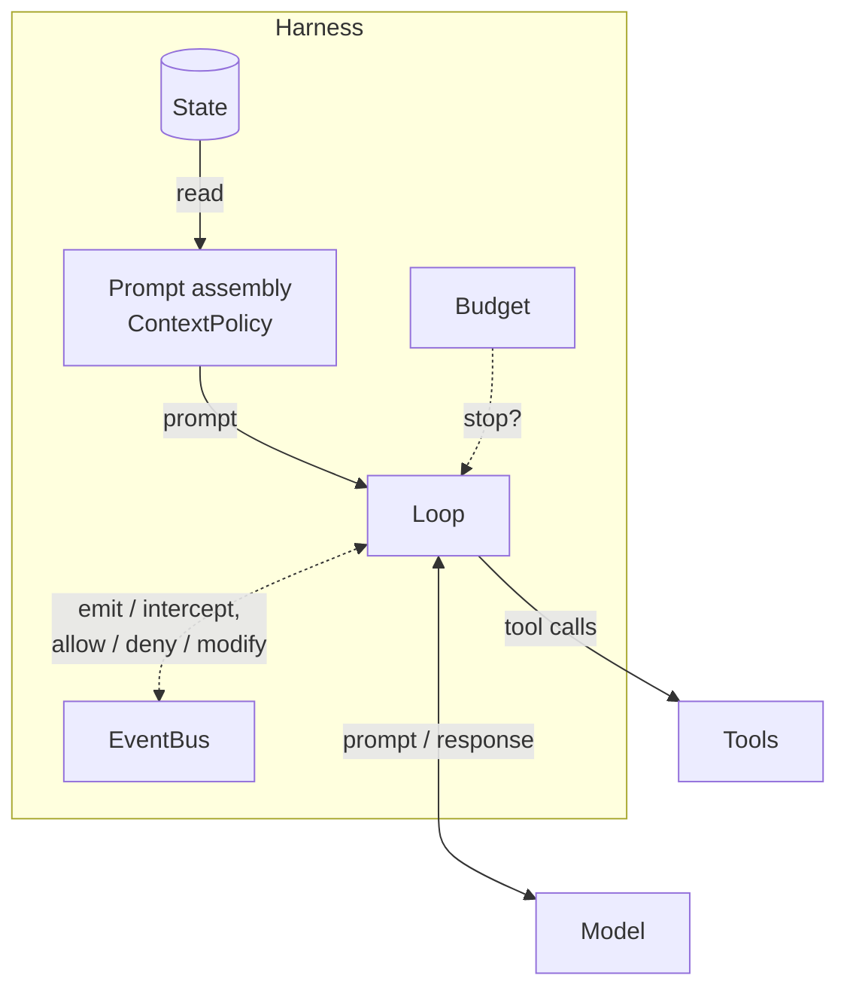

*Graph 4: The parts of the harness and the path of one step through them.*

### State

The state is the complete record of a run: the system prompt, the conversation, the usage so far and metadata such as the model used.

```python
# region Needed from earlier sections
from dataclasses import dataclass
from typing import Literal

@dataclass
class Text:
    text: str

@dataclass
class ToolCall:
    id: str
    name: str
    input: dict

@dataclass
class ToolResult:
    call_id: str
    content: list[Text]
    is_error: bool = False

@dataclass
class Thinking:
    text: str

ContentBlock = Text | ToolCall | ToolResult | Thinking

@dataclass
class Message:
    role: Literal["user", "assistant"]
    content: list[ContentBlock]

conversation = [
    Message("user", [Text("How many lines does notes.txt have?")]),
    Message("assistant", [
        ToolCall(id="c1", name="read_file", input={"path": "notes.txt"}),
    ]),
    Message("user", [
        ToolResult(call_id="c1", content=[Text("first\nsecond\nthird")]),
    ]),
    Message("assistant", [Text("notes.txt has 3 lines.")]),
]

@dataclass
class Usage:
    input_tokens: int
    output_tokens: int
    cost: float
    seconds: float
# endregion

from dataclasses import dataclass

@dataclass
class RunState:
    system: str
    messages: list[Message]
    usage: Usage
    metadata: dict

# Example: the state after the run from Graph 2
state = RunState(
    system="You are a helpful assistant.",
    messages=conversation,
    usage=Usage(input_tokens=90, output_tokens=25, cost=0.0003, seconds=0.2),
    metadata={"model": "fake"},
)
print(f"{len(state.messages)} messages, {state.usage}")
```

Because the state is data, a run can be saved and resumed later, inspected after it ends, or moved to another machine, without any change to the loop.

### Prompt assembly

Before each model call, the harness builds a prompt from:

- The system prompt.
- Skills: instructions for specific kinds of work, added when they are relevant.
- The conversation, including earlier tool calls and results.
- The definitions of the available tools.

What the model actually sees on each call is decided by a context policy. It can cut large tool outputs, replace old parts of the conversation with a summary, inject skills or current information, or hide tools that do not apply. The policy changes only the prompt and leaves the state as it is.

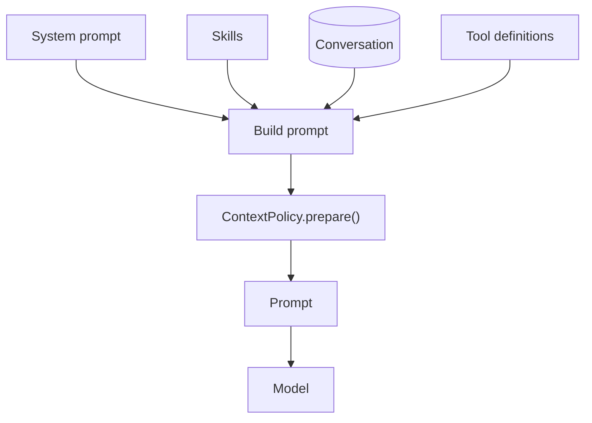

*Graph 5: How the prompt for one model call is built.*

```python
# region Needed from earlier sections
from dataclasses import dataclass
from typing import Literal

@dataclass
class Text:
    text: str

@dataclass
class ToolCall:
    id: str
    name: str
    input: dict

@dataclass
class ToolResult:
    call_id: str
    content: list[Text]
    is_error: bool = False

@dataclass
class Thinking:
    text: str

ContentBlock = Text | ToolCall | ToolResult | Thinking

@dataclass
class Message:
    role: Literal["user", "assistant"]
    content: list[ContentBlock]

conversation = [
    Message("user", [Text("How many lines does notes.txt have?")]),
    Message("assistant", [
        ToolCall(id="c1", name="read_file", input={"path": "notes.txt"}),
    ]),
    Message("user", [
        ToolResult(call_id="c1", content=[Text("first\nsecond\nthird")]),
    ]),
    Message("assistant", [Text("notes.txt has 3 lines.")]),
]

@dataclass
class ToolDefinition:
    name: str
    description: str
    input_schema: dict  # JSON Schema of the input

@dataclass
class Prompt:
    system: str
    messages: list[Message]
    tools: list[ToolDefinition]

read_file = ToolDefinition(
    name="read_file",
    description="Read a text file and return its content.",
    input_schema={
        "type": "object",
        "properties": {"path": {"type": "string"}},
        "required": ["path"],
    },
)

prompt = Prompt(
    system="You are a helpful assistant.",
    messages=conversation[:1],
    tools=[read_file],
)

@dataclass
class Usage:
    input_tokens: int
    output_tokens: int
    cost: float
    seconds: float

@dataclass
class RunState:
    system: str
    messages: list[Message]
    usage: Usage
    metadata: dict

state = RunState(
    system="You are a helpful assistant.",
    messages=conversation,
    usage=Usage(input_tokens=90, output_tokens=25, cost=0.0003, seconds=0.2),
    metadata={"model": "fake"},
)
# endregion

import asyncio
from abc import ABC, abstractmethod
from datetime import datetime

class ContextPolicy(ABC):
    @abstractmethod
    async def prepare(self, state: RunState, prompt: Prompt) -> Prompt:
        """Return the prompt the model sees on this call."""

# Example: a policy that adds the current time to the system prompt
class AddTime(ContextPolicy):
    async def prepare(self, state, prompt):
        system = f"{prompt.system}\nTime: {datetime.now():%H:%M}"
        return Prompt(system, prompt.messages, prompt.tools)

print(asyncio.run(AddTime().prepare(state, prompt)).system)
```

### Loop

The loop advances the state one step at a time. One step builds a prompt, calls the model and appends the response. If the response contains tool calls, the loop executes them, in parallel when possible, appends the results and takes another step. Otherwise the run ends. Along the way the loop emits events to the event bus, and each tool call passes through the bus before it is executed, so the bus can allow, deny or replace it (see Events below).

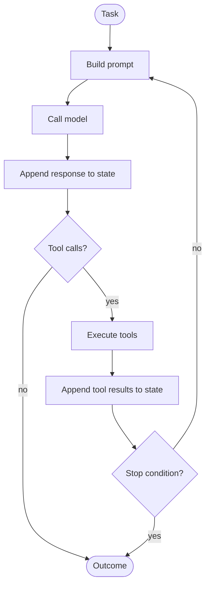

*Graph 6: The loop, from a task to an outcome.*

```python
# region Needed from earlier sections
from abc import ABC, abstractmethod
from collections.abc import AsyncIterator
from dataclasses import dataclass
from typing import Literal

@dataclass
class Text:
    text: str

@dataclass
class ToolCall:
    id: str
    name: str
    input: dict

@dataclass
class ToolResult:
    call_id: str
    content: list[Text]
    is_error: bool = False

@dataclass
class Thinking:
    text: str

ContentBlock = Text | ToolCall | ToolResult | Thinking

@dataclass
class Message:
    role: Literal["user", "assistant"]
    content: list[ContentBlock]

@dataclass
class ToolDefinition:
    name: str
    description: str
    input_schema: dict  # JSON Schema of the input

@dataclass
class Prompt:
    system: str
    messages: list[Message]
    tools: list[ToolDefinition]

StopReason = Literal[
    "end_turn",    # the model has finished
    "tool_use",    # the model asks for tool calls
    "max_tokens",  # the model was cut off at the output limit
    "refusal",     # the model declined to continue
]

@dataclass
class Usage:
    input_tokens: int
    output_tokens: int
    cost: float
    seconds: float

@dataclass
class Response:
    content: list[ContentBlock]
    stop_reason: StopReason
    usage: Usage

@dataclass
class Capabilities:
    context_window: int
    tool_calling: bool

ModelEvent = str | Response

class Model(ABC):
    @abstractmethod
    async def complete(self, prompt: Prompt) -> Response:
        """Send the prompt and wait for the whole response."""

    @abstractmethod
    def stream(self, prompt: Prompt) -> AsyncIterator[ModelEvent]:
        """Yield the response as it is produced, then the whole response."""

    @abstractmethod
    def capabilities(self) -> Capabilities:
        """What the model supports: context window, tools, images."""

@dataclass
class RunState:
    system: str
    messages: list[Message]
    usage: Usage
    metadata: dict
# endregion

from abc import ABC, abstractmethod
from dataclasses import dataclass

@dataclass
class Outcome:
    answer: str
    # Why the run ended: a stop reason, an exhausted budget or cancellation.
    reason: str
    usage: Usage

class Loop(ABC):
    @abstractmethod
    async def step(
        self, state: RunState, model: Model, harness: "Harness"
    ) -> bool:
        """One model call and its tool calls. True if the run goes on."""

    @abstractmethod
    async def run(
        self, state: RunState, model: Model, harness: "Harness"
    ) -> Outcome:
        """Take steps until a stop condition."""

# Example: a simple loop, run in the Agent example below
# The event bus is defined in the Events section below.
async def emit(harness, kind, data):
    if harness.events:
        await harness.events.emit(Event(kind, data))

class SimpleLoop(Loop):
    async def step(self, state, model, harness):
        # Build the prompt from the state and the tool definitions,
        # then let the context policy adjust it.
        definitions = [t.definition for t in harness.tools]
        prompt = Prompt(state.system, state.messages, definitions)
        if harness.policy:
            prompt = await harness.policy.prepare(state, prompt)

        # Call the model and charge its usage to the budget and the state.
        await emit(harness, "model_call", prompt)
        response = await model.complete(prompt)
        await emit(harness, "model_response", response)
        harness.budget.charge(response.usage)
        state.usage.input_tokens += response.usage.input_tokens
        state.usage.output_tokens += response.usage.output_tokens
        state.messages.append(Message("assistant", response.content))

        # No tool calls: the model has finished, the run ends.
        calls = [b for b in response.content if isinstance(b, ToolCall)]
        if not calls:
            return False

        # Execute each tool call in order and collect the results.
        # The event bus sees each call first and can deny or replace it.
        tools = {t.definition.name: t for t in harness.tools}
        results = []
        for call in calls:
            await emit(harness, "tool_call", call)
            decision = Allow()
            if harness.events:
                decision = await harness.events.intercept(call)
            match decision:
                case Deny(reason):
                    output = ToolOutput([Text(reason)], is_error=True)
                case Replace(changed):
                    output = await tools[changed.name].execute(changed.input)
                case _:
                    output = await tools[call.name].execute(call.input)
            result = ToolResult(call.id, output.content, output.is_error)
            await emit(harness, "tool_result", result)
            results.append(result)

        # All results go back to the model in one user message.
        state.messages.append(Message("user", results))

        # Take another step unless the budget is exhausted.
        return not harness.budget.exhausted()

    async def run(self, state, model, harness):
        while await self.step(state, model, harness):
            pass
        reason = "budget" if harness.budget.exhausted() else "end_turn"
        # The answer is the text of the last message, without thinking.
        last = state.messages[-1].content
        answer = "".join(b.text for b in last if isinstance(b, Text))
        return Outcome(answer, reason, state.usage)

print("SimpleLoop is ready. It runs in the Agent example in section 6.")
```

### Stop conditions and budget

A run ends when:

- The model finishes its turn.
- The model is cut off or refuses.
- The budget is exhausted: steps, tokens, cost or time.
- The run is cancelled from outside.

The budget is required, so every agent has a guaranteed end, even when the model never stops calling tools.

```python
# region Needed from earlier sections
from dataclasses import dataclass
from typing import Literal

@dataclass
class Text:
    text: str

@dataclass
class ToolCall:
    id: str
    name: str
    input: dict

@dataclass
class ToolResult:
    call_id: str
    content: list[Text]
    is_error: bool = False

@dataclass
class Thinking:
    text: str

ContentBlock = Text | ToolCall | ToolResult | Thinking

StopReason = Literal[
    "end_turn",    # the model has finished
    "tool_use",    # the model asks for tool calls
    "max_tokens",  # the model was cut off at the output limit
    "refusal",     # the model declined to continue
]

@dataclass
class Usage:
    input_tokens: int
    output_tokens: int
    cost: float
    seconds: float

@dataclass
class Response:
    content: list[ContentBlock]
    stop_reason: StopReason
    usage: Usage

response = Response(
    content=[ToolCall(id="c1", name="read_file", input={"path": "notes.txt"})],
    stop_reason="tool_use",
    usage=Usage(input_tokens=120, output_tokens=25, cost=0.0004, seconds=0.8),
)
# endregion

from abc import ABC, abstractmethod

class Budget(ABC):
    @abstractmethod
    def charge(self, usage: Usage) -> None: ...

    @abstractmethod
    def exhausted(self) -> bool: ...

    @abstractmethod
    def child(self, limit: Usage) -> "Budget":
        """A budget for a sub-agent, bounded by what is left of this one."""

# Example: a budget that counts model calls
class StepBudget(Budget):
    def __init__(self, max_steps):
        self.max_steps, self.steps = max_steps, 0

    def charge(self, usage):
        self.steps += 1

    def exhausted(self):
        return self.steps >= self.max_steps

    def child(self, limit):  # fake: ignores the limit
        return StepBudget(self.max_steps - self.steps)

budget = StepBudget(max_steps=1)
budget.charge(response.usage)
print("exhausted:", budget.exhausted())
```

### Events

The loop emits an event at each fixed point of a step: before a model call, after a response, before a tool call and after a tool result. Handlers attached to the event bus observe these events, for logging, tracing or a user interface. Before a tool is executed, the bus can also intercept the call: allow it, deny it, or replace it with a changed call. Permission checks, human approval and safety limits are built this way, outside the loop.

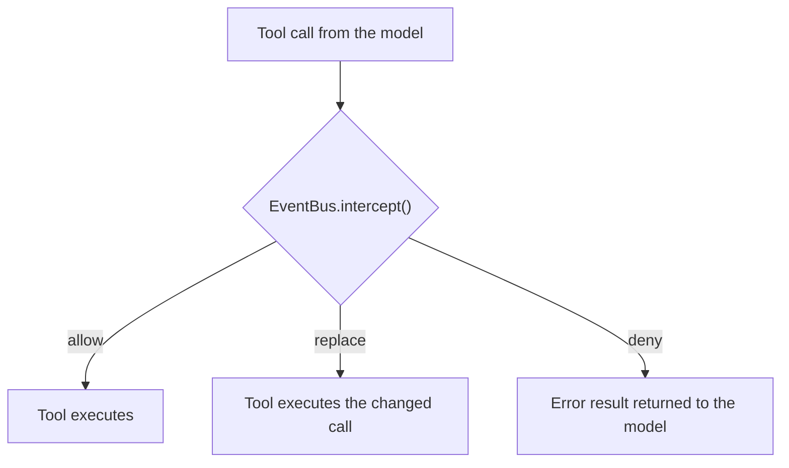

*Graph 7: The three possible decisions of the event bus on a tool call.*

```python
# region Needed from earlier sections
from dataclasses import dataclass

@dataclass
class ToolCall:
    id: str
    name: str
    input: dict
# endregion

import asyncio
from abc import ABC, abstractmethod
from dataclasses import dataclass
from typing import Literal

@dataclass
class Event:
    kind: Literal["model_call", "model_response", "tool_call", "tool_result"]
    data: object

@dataclass
class Allow: ...

@dataclass
class Deny:
    reason: str

@dataclass
class Replace:
    call: ToolCall

Decision = Allow | Deny | Replace

class EventBus(ABC):
    @abstractmethod
    async def emit(self, event: Event) -> None: ...

    @abstractmethod
    async def intercept(self, call: ToolCall) -> Decision: ...

# Example: a bus that prints every event and denies rm
class PrintAndGuard(EventBus):
    async def emit(self, event):
        print(event.kind, event.data)

    async def intercept(self, call):
        if call.name == "bash" and "rm " in call.input["command"]:
            return Deny("rm is not allowed")
        return Allow()

bus = PrintAndGuard()
asyncio.run(bus.emit(Event("tool_call", {"name": "bash", "command": "ls"})))
call = ToolCall("c2", "bash", {"command": "rm my-important-notes.txt"})
print(asyncio.run(bus.intercept(call)))
```

### The harness as one object

The harness collects these parts. Only the loop and the budget are required. Without tools the model can only answer in text, without a policy it sees the state as it is, and without an event bus nothing is observed and every tool call is allowed.

```python
# region Needed from earlier sections
from abc import ABC, abstractmethod
from collections.abc import AsyncIterator
from dataclasses import dataclass
from datetime import datetime
from typing import Literal

@dataclass
class Text:
    text: str

@dataclass
class ToolCall:
    id: str
    name: str
    input: dict

@dataclass
class ToolResult:
    call_id: str
    content: list[Text]
    is_error: bool = False

@dataclass
class Thinking:
    text: str

ContentBlock = Text | ToolCall | ToolResult | Thinking

@dataclass
class Message:
    role: Literal["user", "assistant"]
    content: list[ContentBlock]

@dataclass
class ToolDefinition:
    name: str
    description: str
    input_schema: dict  # JSON Schema of the input

@dataclass
class Prompt:
    system: str
    messages: list[Message]
    tools: list[ToolDefinition]

read_file = ToolDefinition(
    name="read_file",
    description="Read a text file and return its content.",
    input_schema={
        "type": "object",
        "properties": {"path": {"type": "string"}},
        "required": ["path"],
    },
)

StopReason = Literal[
    "end_turn",    # the model has finished
    "tool_use",    # the model asks for tool calls
    "max_tokens",  # the model was cut off at the output limit
    "refusal",     # the model declined to continue
]

@dataclass
class Usage:
    input_tokens: int
    output_tokens: int
    cost: float
    seconds: float

@dataclass
class Response:
    content: list[ContentBlock]
    stop_reason: StopReason
    usage: Usage

@dataclass
class Capabilities:
    context_window: int
    tool_calling: bool

ModelEvent = str | Response

class Model(ABC):
    @abstractmethod
    async def complete(self, prompt: Prompt) -> Response:
        """Send the prompt and wait for the whole response."""

    @abstractmethod
    def stream(self, prompt: Prompt) -> AsyncIterator[ModelEvent]:
        """Yield the response as it is produced, then the whole response."""

    @abstractmethod
    def capabilities(self) -> Capabilities:
        """What the model supports: context window, tools, images."""

@dataclass
class ToolOutput:
    content: list[Text]
    is_error: bool = False

class Tool(ABC):
    @property
    @abstractmethod
    def definition(self) -> ToolDefinition:
        """Name, description and input schema, sent to the model."""

    @abstractmethod
    async def execute(self, input: dict) -> ToolOutput:
        """Do the work. Return errors as output, with is_error set."""

class ReadFile(Tool):
    definition = read_file

    async def execute(self, input):
        return ToolOutput([Text("Here is the content of the file.")])

@dataclass
class RunState:
    system: str
    messages: list[Message]
    usage: Usage
    metadata: dict

class ContextPolicy(ABC):
    @abstractmethod
    async def prepare(self, state: RunState, prompt: Prompt) -> Prompt:
        """Return the prompt the model sees on this call."""

class AddTime(ContextPolicy):
    async def prepare(self, state, prompt):
        system = f"{prompt.system}\nTime: {datetime.now():%H:%M}"
        return Prompt(system, prompt.messages, prompt.tools)

@dataclass
class Outcome:
    answer: str
    # Why the run ended: a stop reason, an exhausted budget or cancellation.
    reason: str
    usage: Usage

class Loop(ABC):
    @abstractmethod
    async def step(
        self, state: RunState, model: Model, harness: "Harness"
    ) -> bool:
        """One model call and its tool calls. True if the run goes on."""

    @abstractmethod
    async def run(
        self, state: RunState, model: Model, harness: "Harness"
    ) -> Outcome:
        """Take steps until a stop condition."""

# The event bus is defined in the Events section below.
async def emit(harness, kind, data):
    if harness.events:
        await harness.events.emit(Event(kind, data))

class SimpleLoop(Loop):
    async def step(self, state, model, harness):
        # Build the prompt from the state and the tool definitions,
        # then let the context policy adjust it.
        definitions = [t.definition for t in harness.tools]
        prompt = Prompt(state.system, state.messages, definitions)
        if harness.policy:
            prompt = await harness.policy.prepare(state, prompt)

        # Call the model and charge its usage to the budget and the state.
        await emit(harness, "model_call", prompt)
        response = await model.complete(prompt)
        await emit(harness, "model_response", response)
        harness.budget.charge(response.usage)
        state.usage.input_tokens += response.usage.input_tokens
        state.usage.output_tokens += response.usage.output_tokens
        state.messages.append(Message("assistant", response.content))

        # No tool calls: the model has finished, the run ends.
        calls = [b for b in response.content if isinstance(b, ToolCall)]
        if not calls:
            return False

        # Execute each tool call in order and collect the results.
        # The event bus sees each call first and can deny or replace it.
        tools = {t.definition.name: t for t in harness.tools}
        results = []
        for call in calls:
            await emit(harness, "tool_call", call)
            decision = Allow()
            if harness.events:
                decision = await harness.events.intercept(call)
            match decision:
                case Deny(reason):
                    output = ToolOutput([Text(reason)], is_error=True)
                case Replace(changed):
                    output = await tools[changed.name].execute(changed.input)
                case _:
                    output = await tools[call.name].execute(call.input)
            result = ToolResult(call.id, output.content, output.is_error)
            await emit(harness, "tool_result", result)
            results.append(result)

        # All results go back to the model in one user message.
        state.messages.append(Message("user", results))

        # Take another step unless the budget is exhausted.
        return not harness.budget.exhausted()

    async def run(self, state, model, harness):
        while await self.step(state, model, harness):
            pass
        reason = "budget" if harness.budget.exhausted() else "end_turn"
        # The answer is the text of the last message, without thinking.
        last = state.messages[-1].content
        answer = "".join(b.text for b in last if isinstance(b, Text))
        return Outcome(answer, reason, state.usage)

class Budget(ABC):
    @abstractmethod
    def charge(self, usage: Usage) -> None: ...

    @abstractmethod
    def exhausted(self) -> bool: ...

    @abstractmethod
    def child(self, limit: Usage) -> "Budget":
        """A budget for a sub-agent, bounded by what is left of this one."""

class StepBudget(Budget):
    def __init__(self, max_steps):
        self.max_steps, self.steps = max_steps, 0

    def charge(self, usage):
        self.steps += 1

    def exhausted(self):
        return self.steps >= self.max_steps

    def child(self, limit):  # fake: ignores the limit
        return StepBudget(self.max_steps - self.steps)

@dataclass
class Event:
    kind: Literal["model_call", "model_response", "tool_call", "tool_result"]
    data: object

@dataclass
class Allow: ...

@dataclass
class Deny:
    reason: str

@dataclass
class Replace:
    call: ToolCall

Decision = Allow | Deny | Replace

class EventBus(ABC):
    @abstractmethod
    async def emit(self, event: Event) -> None: ...

    @abstractmethod
    async def intercept(self, call: ToolCall) -> Decision: ...
# endregion

from dataclasses import dataclass, field

@dataclass
class Harness:
    loop: Loop
    budget: Budget
    tools: list[Tool] = field(default_factory=list)
    policy: ContextPolicy | None = None
    events: EventBus | None = None

# Example: a harness made of the examples above
harness = Harness(
    loop=SimpleLoop(),
    budget=StepBudget(max_steps=5),
    tools=[ReadFile()],
    policy=AddTime(),
)
print(harness)
```

## 6. Agent

An agent is a model, a system prompt and a harness, put together. It owns one state and continues it on every run, so the same agent can be given several tasks in a row and remember the earlier ones.

```python
# region Needed from earlier sections
from abc import ABC, abstractmethod
from collections.abc import AsyncIterator
from dataclasses import dataclass, field
from datetime import datetime
from typing import Literal

@dataclass
class Text:
    text: str

@dataclass
class ToolCall:
    id: str
    name: str
    input: dict

@dataclass
class ToolResult:
    call_id: str
    content: list[Text]
    is_error: bool = False

@dataclass
class Thinking:
    text: str

ContentBlock = Text | ToolCall | ToolResult | Thinking

@dataclass
class Message:
    role: Literal["user", "assistant"]
    content: list[ContentBlock]

@dataclass
class ToolDefinition:
    name: str
    description: str
    input_schema: dict  # JSON Schema of the input

@dataclass
class Prompt:
    system: str
    messages: list[Message]
    tools: list[ToolDefinition]

read_file = ToolDefinition(
    name="read_file",
    description="Read a text file and return its content.",
    input_schema={
        "type": "object",
        "properties": {"path": {"type": "string"}},
        "required": ["path"],
    },
)

StopReason = Literal[
    "end_turn",    # the model has finished
    "tool_use",    # the model asks for tool calls
    "max_tokens",  # the model was cut off at the output limit
    "refusal",     # the model declined to continue
]

@dataclass
class Usage:
    input_tokens: int
    output_tokens: int
    cost: float
    seconds: float

@dataclass
class Response:
    content: list[ContentBlock]
    stop_reason: StopReason
    usage: Usage

@dataclass
class Capabilities:
    context_window: int
    tool_calling: bool

ModelEvent = str | Response

class Model(ABC):
    @abstractmethod
    async def complete(self, prompt: Prompt) -> Response:
        """Send the prompt and wait for the whole response."""

    @abstractmethod
    def stream(self, prompt: Prompt) -> AsyncIterator[ModelEvent]:
        """Yield the response as it is produced, then the whole response."""

    @abstractmethod
    def capabilities(self) -> Capabilities:
        """What the model supports: context window, tools, images."""

class FakeModel(Model):
    async def complete(self, prompt):
        text = Text("Hi, I am a fake model.")
        return Response([text], "end_turn", Usage(40, 10, 0.0, 0.1))

    async def stream(self, prompt):
        yield await self.complete(prompt)

    def capabilities(self):
        return Capabilities(context_window=8_000, tool_calling=True)

@dataclass
class ToolOutput:
    content: list[Text]
    is_error: bool = False

class Tool(ABC):
    @property
    @abstractmethod
    def definition(self) -> ToolDefinition:
        """Name, description and input schema, sent to the model."""

    @abstractmethod
    async def execute(self, input: dict) -> ToolOutput:
        """Do the work. Return errors as output, with is_error set."""

class ReadFile(Tool):
    definition = read_file

    async def execute(self, input):
        return ToolOutput([Text("Here is the content of the file.")])

@dataclass
class RunState:
    system: str
    messages: list[Message]
    usage: Usage
    metadata: dict

class ContextPolicy(ABC):
    @abstractmethod
    async def prepare(self, state: RunState, prompt: Prompt) -> Prompt:
        """Return the prompt the model sees on this call."""

class AddTime(ContextPolicy):
    async def prepare(self, state, prompt):
        system = f"{prompt.system}\nTime: {datetime.now():%H:%M}"
        return Prompt(system, prompt.messages, prompt.tools)

@dataclass
class Outcome:
    answer: str
    # Why the run ended: a stop reason, an exhausted budget or cancellation.
    reason: str
    usage: Usage

class Loop(ABC):
    @abstractmethod
    async def step(
        self, state: RunState, model: Model, harness: "Harness"
    ) -> bool:
        """One model call and its tool calls. True if the run goes on."""

    @abstractmethod
    async def run(
        self, state: RunState, model: Model, harness: "Harness"
    ) -> Outcome:
        """Take steps until a stop condition."""

# The event bus is defined in the Events section below.
async def emit(harness, kind, data):
    if harness.events:
        await harness.events.emit(Event(kind, data))

class SimpleLoop(Loop):
    async def step(self, state, model, harness):
        # Build the prompt from the state and the tool definitions,
        # then let the context policy adjust it.
        definitions = [t.definition for t in harness.tools]
        prompt = Prompt(state.system, state.messages, definitions)
        if harness.policy:
            prompt = await harness.policy.prepare(state, prompt)

        # Call the model and charge its usage to the budget and the state.
        await emit(harness, "model_call", prompt)
        response = await model.complete(prompt)
        await emit(harness, "model_response", response)
        harness.budget.charge(response.usage)
        state.usage.input_tokens += response.usage.input_tokens
        state.usage.output_tokens += response.usage.output_tokens
        state.messages.append(Message("assistant", response.content))

        # No tool calls: the model has finished, the run ends.
        calls = [b for b in response.content if isinstance(b, ToolCall)]
        if not calls:
            return False

        # Execute each tool call in order and collect the results.
        # The event bus sees each call first and can deny or replace it.
        tools = {t.definition.name: t for t in harness.tools}
        results = []
        for call in calls:
            await emit(harness, "tool_call", call)
            decision = Allow()
            if harness.events:
                decision = await harness.events.intercept(call)
            match decision:
                case Deny(reason):
                    output = ToolOutput([Text(reason)], is_error=True)
                case Replace(changed):
                    output = await tools[changed.name].execute(changed.input)
                case _:
                    output = await tools[call.name].execute(call.input)
            result = ToolResult(call.id, output.content, output.is_error)
            await emit(harness, "tool_result", result)
            results.append(result)

        # All results go back to the model in one user message.
        state.messages.append(Message("user", results))

        # Take another step unless the budget is exhausted.
        return not harness.budget.exhausted()

    async def run(self, state, model, harness):
        while await self.step(state, model, harness):
            pass
        reason = "budget" if harness.budget.exhausted() else "end_turn"
        # The answer is the text of the last message, without thinking.
        last = state.messages[-1].content
        answer = "".join(b.text for b in last if isinstance(b, Text))
        return Outcome(answer, reason, state.usage)

class Budget(ABC):
    @abstractmethod
    def charge(self, usage: Usage) -> None: ...

    @abstractmethod
    def exhausted(self) -> bool: ...

    @abstractmethod
    def child(self, limit: Usage) -> "Budget":
        """A budget for a sub-agent, bounded by what is left of this one."""

class StepBudget(Budget):
    def __init__(self, max_steps):
        self.max_steps, self.steps = max_steps, 0

    def charge(self, usage):
        self.steps += 1

    def exhausted(self):
        return self.steps >= self.max_steps

    def child(self, limit):  # fake: ignores the limit
        return StepBudget(self.max_steps - self.steps)

@dataclass
class Event:
    kind: Literal["model_call", "model_response", "tool_call", "tool_result"]
    data: object

@dataclass
class Allow: ...

@dataclass
class Deny:
    reason: str

@dataclass
class Replace:
    call: ToolCall

Decision = Allow | Deny | Replace

class EventBus(ABC):
    @abstractmethod
    async def emit(self, event: Event) -> None: ...

    @abstractmethod
    async def intercept(self, call: ToolCall) -> Decision: ...

@dataclass
class Harness:
    loop: Loop
    budget: Budget
    tools: list[Tool] = field(default_factory=list)
    policy: ContextPolicy | None = None
    events: EventBus | None = None

harness = Harness(
    loop=SimpleLoop(),
    budget=StepBudget(max_steps=5),
    tools=[ReadFile()],
    policy=AddTime(),
)
# endregion

import asyncio

class Agent:
    def __init__(self, model: Model, system: str, harness: Harness):
        self.model, self.harness = model, harness
        self.state = RunState(system, [], Usage(0, 0, 0.0, 0.0), {})

    async def run(self, task: str) -> Outcome:
        """Append the task to the state, then run the loop until it stops."""
        self.state.messages.append(Message("user", [Text(task)]))
        harness = self.harness
        return await harness.loop.run(self.state, self.model, harness)

# Example: an agent made of the examples above
agent = Agent(FakeModel(), "You are a helpful assistant.", harness)
print(asyncio.run(agent.run("How many lines does notes.txt have?")))
```

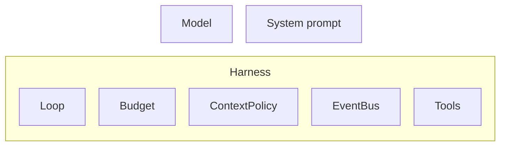

*Graph 8: An agent as a set of replaceable blocks.*

Each box in this diagram is a block that can be replaced by another implementation of the same interface.

## 7. Composition

An agent can be used as a tool by another agent. The handler of such a tool starts a new run of the inner agent with a fresh state, and returns its final answer as the tool result. For the outer agent, the inner one is a tool like any other.

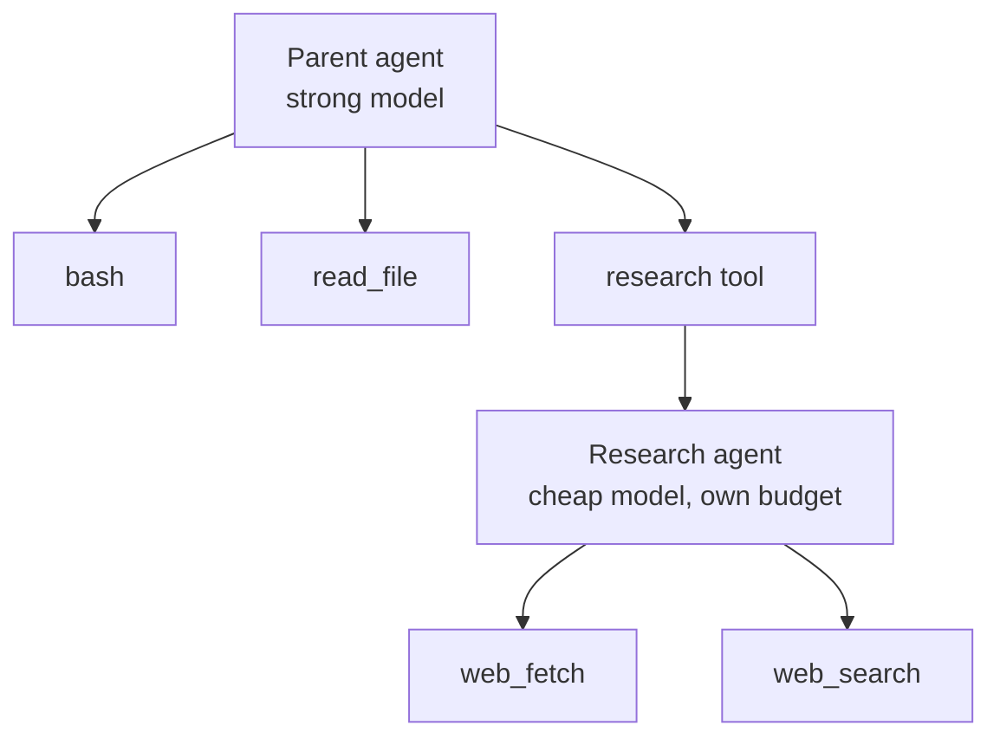

*Graph 9: A parent agent that uses a research agent as a tool.*

This gives sub-agents, parallel sub-tasks, recursion and a different model for each sub-agent, with no new concepts. A sub-agent gets its own budget, created with `Budget.child()` and bounded by what is left of the parent's, so a runaway sub-agent cannot use up the parent.

## 8. How the components work together

The diagram follows one step of the loop from top to bottom. Each box is a component and each label is the call or the data passed to the next one.

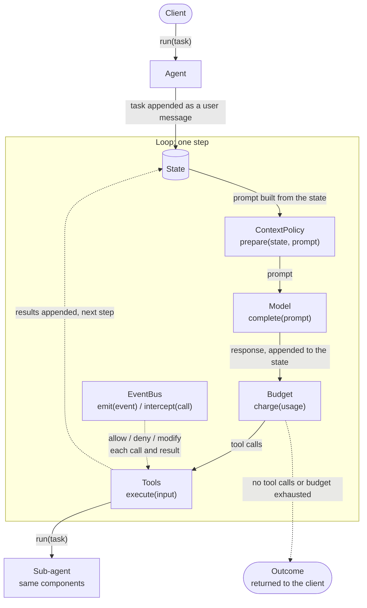

*Graph 10: One step of the loop through all components.*

One run:

1. The client gives the agent a task. The agent appends it to the state as a user message and starts the loop.
2. The loop builds a prompt from the state and the tool definitions, and the context policy adjusts it.
3. The model returns a response. The loop appends it to the state and charges its usage to the budget.
4. If the response contains tool calls, the loop asks the event bus to intercept each call, executes the allowed ones, lets the bus intercept each result and appends the results to the state.
5. Steps 2 to 4 repeat until a stop condition is reached.
6. The loop returns the outcome: the final answer, the reason the run ended and the usage.

## 9. Example: a home assistant

The home assistant is an agent that controls a home on request. It turns lights on and off, plays music, reads the temperature inside and outside, and checks the weather forecast.

### What it does

A request from a resident goes into the assistant. Actions in the home and a reply come out of it.

A simple command, one tool call:

```text
21:05  user       Turn off the living room lights.
21:05  assistant  lights_off("living room")
21:05  assistant  The living room lights are off.
```

A question that needs several readings before the answer:

```text
13:20  user       Should I open the window?
13:20  assistant  get_temperature("inside"): 24°C
13:20  assistant  get_temperature("outside"): 18°C
13:20  assistant  get_forecast("today"): sunny, no rain
13:20  assistant  Yes. It is 24°C inside and 18°C outside, and no rain is expected today.
```

A request by mood. `play_music` needs a song name, so the assistant first asks the DJ sub-agent to pick one:

```text
19:30  user       Play something calm.
19:30  assistant  pick_song("something calm"): "Clair de Lune" by Debussy
19:30  assistant  play_music("Clair de Lune")
19:30  assistant  Playing "Clair de Lune" by Debussy.
```

A request blocked by a guard rule:

```text
23:10  user       Play "Thunderstruck".
23:10  assistant  play_music("Thunderstruck")
23:10  guard      denied: quiet hours, 22:00 to 07:00
23:10  assistant  It is quiet hours until 07:00, so I cannot play music now.
```

### Components

Every request from a resident becomes a task for `run()`, and the final answer of the run is the reply.

- Model: Claude Haiku 5.5 from the Anthropic API.
- System prompt: `ASSISTANT_PROMPT`, the role of the assistant and the morning routine.
- Policy: `HomeStatusPolicy`, adds the current time and the state of the home to every prompt.
- Budget: 8 steps per request.
- Events: `HomeEvents`, a log of every tool call and result, and one guard rule: no music during quiet hours, from 22:00 to 07:00.

The tools:

- `lights_on(room)` and `lights_off(room)`: switch the lights in one room: kitchen, living room or bedroom.
- `play_music(song)`: plays a song by its name.
- `stop_music()`: stops the music.
- `get_temperature(where)`: the temperature "inside" or "outside", in °C.
- `get_forecast(day)`: the weather forecast for "today" or "tomorrow".
- `pick_song(task)`: a sub-agent, the DJ, with no tools and a one-step budget. It turns a task such as "something calm" into a song name.

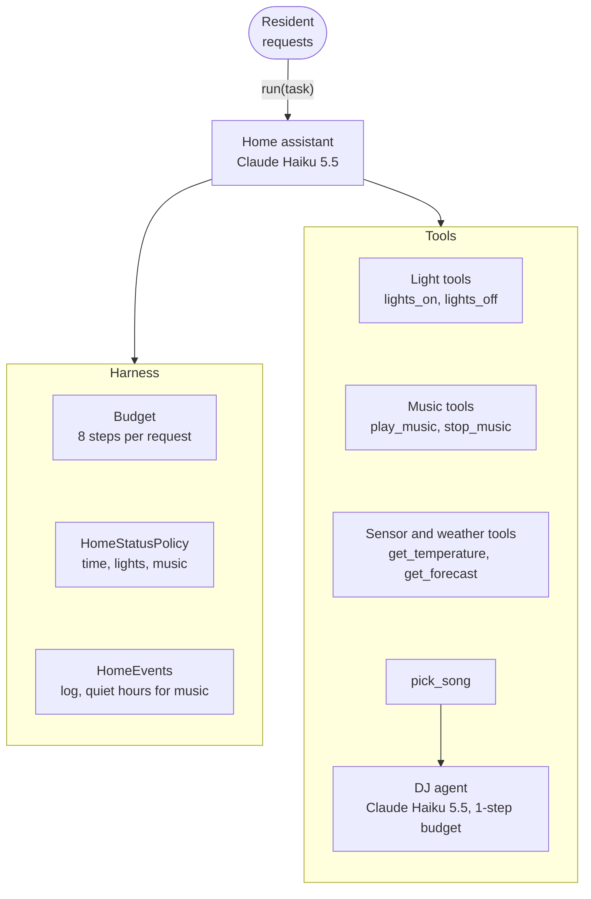

*Graph 11: The components of the home assistant.*

### Prompts

The system prompts of the assistant and of the DJ:

```python
ASSISTANT_PROMPT = """
You are a home assistant. You control the lights and the music in the home and you report the temperature and the weather.

The home has three rooms: kitchen, living room and bedroom. The current time and the state of the home are given below.

To play music, you need a song name. If the resident names a song, play it. If the resident describes a mood or an occasion, ask pick_song for a song first.

When the resident says good morning, run the morning routine:
1. Read the temperature inside and outside and the forecast for today.
2. Turn on the kitchen lights.
3. Play a calm song for the morning.
4. Answer with a short briefing: the temperatures, the forecast and one practical tip.

Answer in one to three short sentences, in plain text. If a tool call is denied, tell the resident why.
"""

DJ_PROMPT = """
You pick songs for a home music player.

You receive a request, such as a mood or an occasion. Pick one well-known song that fits it.

Answer with the song name and the artist only, for example: "Clair de Lune" by Debussy.
"""
```

### The home

The example runs without real devices. `Home` simulates them: the lights in each room, the song that is playing, the two thermometers and the forecast. It also holds the current time, so that a whole day can be run in a few seconds. The tools, the policy and the event bus below all read or change the same `Home`.

```python
from dataclasses import dataclass, field
from datetime import datetime

@dataclass
class Home:
    """A simulated home: the devices the tools act on."""
    now: datetime
    lights: dict[str, bool] = field(default_factory=lambda: {
        "kitchen": False, "living room": False, "bedroom": False,
    })
    song: str | None = None
    temperature: dict[str, int] = field(default_factory=lambda: {
        "inside": 21, "outside": 5,
    })
    forecast: dict[str, str] = field(default_factory=lambda: {
        "today": "cloudy, rain from 14:00 to 18:00, high 8°C",
        "tomorrow": "sunny, high 11°C",
    })

# Example: the home on Monday morning, with everything off
home = Home(now=datetime(2026, 11, 23, 7, 15))
print(home)
```

### Tools

Each tool is a definition and a handler that acts on the home. The `enum` lists in the input schemas tell the model the only valid rooms, places and days.

```python
# region Needed from earlier sections
from abc import ABC, abstractmethod
from dataclasses import dataclass, field
from datetime import datetime

@dataclass
class Text:
    text: str

@dataclass
class ToolDefinition:
    name: str
    description: str
    input_schema: dict  # JSON Schema of the input

@dataclass
class ToolOutput:
    content: list[Text]
    is_error: bool = False

class Tool(ABC):
    @property
    @abstractmethod
    def definition(self) -> ToolDefinition:
        """Name, description and input schema, sent to the model."""

    @abstractmethod
    async def execute(self, input: dict) -> ToolOutput:
        """Do the work. Return errors as output, with is_error set."""

@dataclass
class Home:
    """A simulated home: the devices the tools act on."""
    now: datetime
    lights: dict[str, bool] = field(default_factory=lambda: {
        "kitchen": False, "living room": False, "bedroom": False,
    })
    song: str | None = None
    temperature: dict[str, int] = field(default_factory=lambda: {
        "inside": 21, "outside": 5,
    })
    forecast: dict[str, str] = field(default_factory=lambda: {
        "today": "cloudy, rain from 14:00 to 18:00, high 8°C",
        "tomorrow": "sunny, high 11°C",
    })
# endregion

import asyncio

ROOM = {"type": "string", "enum": ["kitchen", "living room", "bedroom"]}

class HomeTool(Tool):
    def __init__(self, home: Home):
        self.home = home

class LightsOn(HomeTool):
    definition = ToolDefinition(
        name="lights_on",
        description="Turn on the lights in one room.",
        input_schema={
            "type": "object",
            "properties": {"room": ROOM},
            "required": ["room"],
        },
    )

    async def execute(self, input):
        self.home.lights[input["room"]] = True
        return ToolOutput([Text(f"The {input['room']} lights are on.")])

class LightsOff(HomeTool):
    definition = ToolDefinition(
        name="lights_off",
        description="Turn off the lights in one room.",
        input_schema={
            "type": "object",
            "properties": {"room": ROOM},
            "required": ["room"],
        },
    )

    async def execute(self, input):
        self.home.lights[input["room"]] = False
        return ToolOutput([Text(f"The {input['room']} lights are off.")])

class PlayMusic(HomeTool):
    definition = ToolDefinition(
        name="play_music",
        description="Play a song by its name.",
        input_schema={
            "type": "object",
            "properties": {"song": {"type": "string"}},
            "required": ["song"],
        },
    )

    async def execute(self, input):
        self.home.song = input["song"]
        return ToolOutput([Text(f"Playing {input['song']}.")])

class StopMusic(HomeTool):
    definition = ToolDefinition(
        name="stop_music",
        description="Stop the music.",
        input_schema={"type": "object", "properties": {}},
    )

    async def execute(self, input):
        if self.home.song is None:
            return ToolOutput([Text("No music is playing.")])
        self.home.song = None
        return ToolOutput([Text("The music is stopped.")])

class GetTemperature(HomeTool):
    definition = ToolDefinition(
        name="get_temperature",
        description="Read the temperature inside or outside the home, in °C.",
        input_schema={
            "type": "object",
            "properties": {
                "where": {"type": "string", "enum": ["inside", "outside"]},
            },
            "required": ["where"],
        },
    )

    async def execute(self, input):
        degrees = self.home.temperature[input["where"]]
        return ToolOutput([Text(f"{degrees}°C")])

class GetForecast(HomeTool):
    definition = ToolDefinition(
        name="get_forecast",
        description="Get the weather forecast for today or tomorrow.",
        input_schema={
            "type": "object",
            "properties": {
                "day": {"type": "string", "enum": ["today", "tomorrow"]},
            },
            "required": ["day"],
        },
    )

    async def execute(self, input):
        return ToolOutput([Text(self.home.forecast[input["day"]])])

# Example: the tools used directly, without a model
home = Home(now=datetime(2026, 11, 23, 7, 15))
print(asyncio.run(LightsOn(home).execute({"room": "kitchen"})))
print(asyncio.run(GetTemperature(home).execute({"where": "outside"})))
print(asyncio.run(PlayMusic(home).execute({"song": "Here Comes the Sun"})))
print(home.lights, home.song)
```

### Context policy

`HomeStatusPolicy` adds the current time and the state of the home to the system prompt before every model call. The model knows which lights are on without calling a tool, and the state in the prompt is always current, even within one run.

```python
# region Needed from earlier sections
from abc import ABC, abstractmethod
from dataclasses import dataclass, field
from datetime import datetime
from typing import Literal

@dataclass
class Text:
    text: str

@dataclass
class ToolCall:
    id: str
    name: str
    input: dict

@dataclass
class ToolResult:
    call_id: str
    content: list[Text]
    is_error: bool = False

@dataclass
class Thinking:
    text: str

ContentBlock = Text | ToolCall | ToolResult | Thinking

@dataclass
class Message:
    role: Literal["user", "assistant"]
    content: list[ContentBlock]

@dataclass
class ToolDefinition:
    name: str
    description: str
    input_schema: dict  # JSON Schema of the input

@dataclass
class Prompt:
    system: str
    messages: list[Message]
    tools: list[ToolDefinition]

@dataclass
class Usage:
    input_tokens: int
    output_tokens: int
    cost: float
    seconds: float

@dataclass
class RunState:
    system: str
    messages: list[Message]
    usage: Usage
    metadata: dict

class ContextPolicy(ABC):
    @abstractmethod
    async def prepare(self, state: RunState, prompt: Prompt) -> Prompt:
        """Return the prompt the model sees on this call."""

@dataclass
class Home:
    """A simulated home: the devices the tools act on."""
    now: datetime
    lights: dict[str, bool] = field(default_factory=lambda: {
        "kitchen": False, "living room": False, "bedroom": False,
    })
    song: str | None = None
    temperature: dict[str, int] = field(default_factory=lambda: {
        "inside": 21, "outside": 5,
    })
    forecast: dict[str, str] = field(default_factory=lambda: {
        "today": "cloudy, rain from 14:00 to 18:00, high 8°C",
        "tomorrow": "sunny, high 11°C",
    })
# endregion

import asyncio

class HomeStatusPolicy(ContextPolicy):
    """Adds the time and the state of the home to the system prompt."""

    def __init__(self, home: Home):
        self.home = home

    async def prepare(self, state, prompt):
        lights = [room for room, on in self.home.lights.items() if on]
        status = (
            f"Time: {self.home.now:%A %H:%M}\n"
            f"Lights on: {', '.join(lights) or 'none'}\n"
            f"Music: {self.home.song or 'not playing'}"
        )
        system = f"{prompt.system}\n\n{status}"
        return Prompt(system, prompt.messages, prompt.tools)

# Example: the system prompt the model sees on Monday morning
home = Home(now=datetime(2026, 11, 23, 7, 15))
home.lights["kitchen"] = True
prompt = Prompt("You are a home assistant.", [], [])
print(asyncio.run(HomeStatusPolicy(home).prepare(None, prompt)).system)
```

### Events

`HomeEvents` does two jobs. It prints a log line for every tool call and every result, and it denies `play_music` during quiet hours. A denied call is not executed: the model gets an error result with the reason, and tells the resident.

```python
# region Needed from earlier sections
from abc import ABC, abstractmethod
from dataclasses import dataclass, field
from datetime import datetime
from typing import Literal

@dataclass
class ToolCall:
    id: str
    name: str
    input: dict

# The event bus is defined in the Events section below.
async def emit(harness, kind, data):
    if harness.events:
        await harness.events.emit(Event(kind, data))

@dataclass
class Event:
    kind: Literal["model_call", "model_response", "tool_call", "tool_result"]
    data: object

@dataclass
class Allow: ...

@dataclass
class Deny:
    reason: str

@dataclass
class Replace:
    call: ToolCall

Decision = Allow | Deny | Replace

class EventBus(ABC):
    @abstractmethod
    async def emit(self, event: Event) -> None: ...

    @abstractmethod
    async def intercept(self, call: ToolCall) -> Decision: ...

@dataclass
class Home:
    """A simulated home: the devices the tools act on."""
    now: datetime
    lights: dict[str, bool] = field(default_factory=lambda: {
        "kitchen": False, "living room": False, "bedroom": False,
    })
    song: str | None = None
    temperature: dict[str, int] = field(default_factory=lambda: {
        "inside": 21, "outside": 5,
    })
    forecast: dict[str, str] = field(default_factory=lambda: {
        "today": "cloudy, rain from 14:00 to 18:00, high 8°C",
        "tomorrow": "sunny, high 11°C",
    })
# endregion

import asyncio
import json

class HomeEvents(EventBus):
    """Logs every tool call and result, and keeps the quiet hours."""

    def __init__(self, home: Home):
        self.home = home

    def log(self, kind, text):
        print(f"{self.home.now:%H:%M}  {kind:<9}  {text}")

    async def emit(self, event):
        match event.kind, event.data:
            case "tool_call", call:
                args = ", ".join(
                    f"{k}={json.dumps(v, ensure_ascii=False)}"
                    for k, v in call.input.items()
                )
                self.log("tool", f"{call.name}({args})")
            case "tool_result", result:
                prefix = "denied: " if result.is_error else ""
                self.log("result", prefix + result.content[0].text)

    async def intercept(self, call):
        hour = self.home.now.hour
        if call.name == "play_music" and (hour >= 22 or hour < 7):
            return Deny("Quiet hours, 22:00 to 07:00. No music now.")
        return Allow()

# Example: the same call at 23:10 and at 09:00
home = Home(now=datetime(2026, 11, 23, 23, 10))
events = HomeEvents(home)
call = ToolCall("c1", "play_music", {"song": "Thunderstruck"})
asyncio.run(events.emit(Event("tool_call", call)))
print(asyncio.run(events.intercept(call)))
home.now = datetime(2026, 11, 23, 9, 0)
print(asyncio.run(events.intercept(call)))
```

### The DJ as a tool

`AgentTool` turns an agent into a tool, as described in section 7. It starts a new agent for every call, so each call runs with a fresh state and a fresh budget. The example runs the DJ on a fake model.

```python
# region Needed from earlier sections
from abc import ABC, abstractmethod
from collections.abc import AsyncIterator
from dataclasses import dataclass, field
from typing import Literal

@dataclass
class Text:
    text: str

@dataclass
class ToolCall:
    id: str
    name: str
    input: dict

@dataclass
class ToolResult:
    call_id: str
    content: list[Text]
    is_error: bool = False

@dataclass
class Thinking:
    text: str

ContentBlock = Text | ToolCall | ToolResult | Thinking

@dataclass
class Message:
    role: Literal["user", "assistant"]
    content: list[ContentBlock]

@dataclass
class ToolDefinition:
    name: str
    description: str
    input_schema: dict  # JSON Schema of the input

@dataclass
class Prompt:
    system: str
    messages: list[Message]
    tools: list[ToolDefinition]

StopReason = Literal[
    "end_turn",    # the model has finished
    "tool_use",    # the model asks for tool calls
    "max_tokens",  # the model was cut off at the output limit
    "refusal",     # the model declined to continue
]

@dataclass
class Usage:
    input_tokens: int
    output_tokens: int
    cost: float
    seconds: float

@dataclass
class Response:
    content: list[ContentBlock]
    stop_reason: StopReason
    usage: Usage

@dataclass
class Capabilities:
    context_window: int
    tool_calling: bool

ModelEvent = str | Response

class Model(ABC):
    @abstractmethod
    async def complete(self, prompt: Prompt) -> Response:
        """Send the prompt and wait for the whole response."""

    @abstractmethod
    def stream(self, prompt: Prompt) -> AsyncIterator[ModelEvent]:
        """Yield the response as it is produced, then the whole response."""

    @abstractmethod
    def capabilities(self) -> Capabilities:
        """What the model supports: context window, tools, images."""

@dataclass
class ToolOutput:
    content: list[Text]
    is_error: bool = False

class Tool(ABC):
    @property
    @abstractmethod
    def definition(self) -> ToolDefinition:
        """Name, description and input schema, sent to the model."""

    @abstractmethod
    async def execute(self, input: dict) -> ToolOutput:
        """Do the work. Return errors as output, with is_error set."""

@dataclass
class RunState:
    system: str
    messages: list[Message]
    usage: Usage
    metadata: dict

class ContextPolicy(ABC):
    @abstractmethod
    async def prepare(self, state: RunState, prompt: Prompt) -> Prompt:
        """Return the prompt the model sees on this call."""

@dataclass
class Outcome:
    answer: str
    # Why the run ended: a stop reason, an exhausted budget or cancellation.
    reason: str
    usage: Usage

class Loop(ABC):
    @abstractmethod
    async def step(
        self, state: RunState, model: Model, harness: "Harness"
    ) -> bool:
        """One model call and its tool calls. True if the run goes on."""

    @abstractmethod
    async def run(
        self, state: RunState, model: Model, harness: "Harness"
    ) -> Outcome:
        """Take steps until a stop condition."""

# The event bus is defined in the Events section below.
async def emit(harness, kind, data):
    if harness.events:
        await harness.events.emit(Event(kind, data))

class SimpleLoop(Loop):
    async def step(self, state, model, harness):
        # Build the prompt from the state and the tool definitions,
        # then let the context policy adjust it.
        definitions = [t.definition for t in harness.tools]
        prompt = Prompt(state.system, state.messages, definitions)
        if harness.policy:
            prompt = await harness.policy.prepare(state, prompt)

        # Call the model and charge its usage to the budget and the state.
        await emit(harness, "model_call", prompt)
        response = await model.complete(prompt)
        await emit(harness, "model_response", response)
        harness.budget.charge(response.usage)
        state.usage.input_tokens += response.usage.input_tokens
        state.usage.output_tokens += response.usage.output_tokens
        state.messages.append(Message("assistant", response.content))

        # No tool calls: the model has finished, the run ends.
        calls = [b for b in response.content if isinstance(b, ToolCall)]
        if not calls:
            return False

        # Execute each tool call in order and collect the results.
        # The event bus sees each call first and can deny or replace it.
        tools = {t.definition.name: t for t in harness.tools}
        results = []
        for call in calls:
            await emit(harness, "tool_call", call)
            decision = Allow()
            if harness.events:
                decision = await harness.events.intercept(call)
            match decision:
                case Deny(reason):
                    output = ToolOutput([Text(reason)], is_error=True)
                case Replace(changed):
                    output = await tools[changed.name].execute(changed.input)
                case _:
                    output = await tools[call.name].execute(call.input)
            result = ToolResult(call.id, output.content, output.is_error)
            await emit(harness, "tool_result", result)
            results.append(result)

        # All results go back to the model in one user message.
        state.messages.append(Message("user", results))

        # Take another step unless the budget is exhausted.
        return not harness.budget.exhausted()

    async def run(self, state, model, harness):
        while await self.step(state, model, harness):
            pass
        reason = "budget" if harness.budget.exhausted() else "end_turn"
        # The answer is the text of the last message, without thinking.
        last = state.messages[-1].content
        answer = "".join(b.text for b in last if isinstance(b, Text))
        return Outcome(answer, reason, state.usage)

class Budget(ABC):
    @abstractmethod
    def charge(self, usage: Usage) -> None: ...

    @abstractmethod
    def exhausted(self) -> bool: ...

    @abstractmethod
    def child(self, limit: Usage) -> "Budget":
        """A budget for a sub-agent, bounded by what is left of this one."""

class StepBudget(Budget):
    def __init__(self, max_steps):
        self.max_steps, self.steps = max_steps, 0

    def charge(self, usage):
        self.steps += 1

    def exhausted(self):
        return self.steps >= self.max_steps

    def child(self, limit):  # fake: ignores the limit
        return StepBudget(self.max_steps - self.steps)

@dataclass
class Event:
    kind: Literal["model_call", "model_response", "tool_call", "tool_result"]
    data: object

@dataclass
class Allow: ...

@dataclass
class Deny:
    reason: str

@dataclass
class Replace:
    call: ToolCall

Decision = Allow | Deny | Replace

class EventBus(ABC):
    @abstractmethod
    async def emit(self, event: Event) -> None: ...

    @abstractmethod
    async def intercept(self, call: ToolCall) -> Decision: ...

@dataclass
class Harness:
    loop: Loop
    budget: Budget
    tools: list[Tool] = field(default_factory=list)
    policy: ContextPolicy | None = None
    events: EventBus | None = None

class Agent:
    def __init__(self, model: Model, system: str, harness: Harness):
        self.model, self.harness = model, harness
        self.state = RunState(system, [], Usage(0, 0, 0.0, 0.0), {})

    async def run(self, task: str) -> Outcome:
        """Append the task to the state, then run the loop until it stops."""
        self.state.messages.append(Message("user", [Text(task)]))
        harness = self.harness
        return await harness.loop.run(self.state, self.model, harness)

DJ_PROMPT = """
You pick songs for a home music player.

You receive a request, such as a mood or an occasion. Pick one well-known song that fits it.

Answer with the song name and the artist only, for example: "Clair de Lune" by Debussy.
"""
# endregion

import asyncio

class AgentTool(Tool):
    """A tool that runs a new agent for each call and returns its answer."""

    def __init__(self, name, description, new_agent):
        self.name, self.description = name, description
        self.new_agent = new_agent

    @property
    def definition(self):
        return ToolDefinition(
            name=self.name,
            description=self.description,
            input_schema={
                "type": "object",
                "properties": {"task": {"type": "string"}},
                "required": ["task"],
            },
        )

    async def execute(self, input):
        outcome = await self.new_agent().run(input["task"])
        return ToolOutput([Text(outcome.answer)])

# Example: the DJ on a fake model that always picks the same song
class FakeDJModel(Model):
    async def complete(self, prompt):
        text = Text('"Here Comes the Sun" by The Beatles')
        return Response([text], "end_turn", Usage(60, 12, 0.0, 0.1))

    async def stream(self, prompt):
        yield await self.complete(prompt)

    def capabilities(self):
        return Capabilities(context_window=8_000, tool_calling=False)

def new_dj():
    return Agent(
        FakeDJModel(),
        DJ_PROMPT,
        Harness(loop=SimpleLoop(), budget=StepBudget(max_steps=1)),
    )

pick_song = AgentTool(
    "pick_song",
    "Pick a song that fits a mood or an occasion. Returns its name and artist.",
    new_dj,
)
print(pick_song.definition)
print(asyncio.run(pick_song.execute({"task": "a calm song for the morning"})))
```

### Composition

The whole assistant, put together from the blocks above and run on Claude Haiku 5.5. Both agents share one model object. Each request starts a new assistant with a fresh state and a fresh 8-step budget, and the home keeps its state between requests.

Running the example requires an Anthropic API key in the `ANTHROPIC_API_KEY` environment variable. The whole day costs less than one cent.

```python
# region Needed from earlier sections
import asyncio
import json
import time
import urllib.request
from abc import ABC, abstractmethod
from collections.abc import AsyncIterator
from dataclasses import dataclass, field
from datetime import datetime
from typing import Literal

@dataclass
class Text:
    text: str

@dataclass
class ToolCall:
    id: str
    name: str
    input: dict

@dataclass
class ToolResult:
    call_id: str
    content: list[Text]
    is_error: bool = False

@dataclass
class Thinking:
    text: str

ContentBlock = Text | ToolCall | ToolResult | Thinking

@dataclass
class Message:
    role: Literal["user", "assistant"]
    content: list[ContentBlock]

@dataclass
class ToolDefinition:
    name: str
    description: str
    input_schema: dict  # JSON Schema of the input

@dataclass
class Prompt:
    system: str
    messages: list[Message]
    tools: list[ToolDefinition]

StopReason = Literal[
    "end_turn",    # the model has finished
    "tool_use",    # the model asks for tool calls
    "max_tokens",  # the model was cut off at the output limit
    "refusal",     # the model declined to continue
]

@dataclass
class Usage:
    input_tokens: int
    output_tokens: int
    cost: float
    seconds: float

@dataclass
class Response:
    content: list[ContentBlock]
    stop_reason: StopReason
    usage: Usage

@dataclass
class Capabilities:
    context_window: int
    tool_calling: bool

ModelEvent = str | Response

class Model(ABC):
    @abstractmethod
    async def complete(self, prompt: Prompt) -> Response:
        """Send the prompt and wait for the whole response."""

    @abstractmethod
    def stream(self, prompt: Prompt) -> AsyncIterator[ModelEvent]:
        """Yield the response as it is produced, then the whole response."""

    @abstractmethod
    def capabilities(self) -> Capabilities:
        """What the model supports: context window, tools, images."""

@dataclass
class ToolOutput:
    content: list[Text]
    is_error: bool = False

class Tool(ABC):
    @property
    @abstractmethod
    def definition(self) -> ToolDefinition:
        """Name, description and input schema, sent to the model."""

    @abstractmethod
    async def execute(self, input: dict) -> ToolOutput:
        """Do the work. Return errors as output, with is_error set."""

@dataclass
class RunState:
    system: str
    messages: list[Message]
    usage: Usage
    metadata: dict

class ContextPolicy(ABC):
    @abstractmethod
    async def prepare(self, state: RunState, prompt: Prompt) -> Prompt:
        """Return the prompt the model sees on this call."""

@dataclass
class Outcome:
    answer: str
    # Why the run ended: a stop reason, an exhausted budget or cancellation.
    reason: str
    usage: Usage

class Loop(ABC):
    @abstractmethod
    async def step(
        self, state: RunState, model: Model, harness: "Harness"
    ) -> bool:
        """One model call and its tool calls. True if the run goes on."""

    @abstractmethod
    async def run(
        self, state: RunState, model: Model, harness: "Harness"
    ) -> Outcome:
        """Take steps until a stop condition."""

# The event bus is defined in the Events section below.
async def emit(harness, kind, data):
    if harness.events:
        await harness.events.emit(Event(kind, data))

class SimpleLoop(Loop):
    async def step(self, state, model, harness):
        # Build the prompt from the state and the tool definitions,
        # then let the context policy adjust it.
        definitions = [t.definition for t in harness.tools]
        prompt = Prompt(state.system, state.messages, definitions)
        if harness.policy:
            prompt = await harness.policy.prepare(state, prompt)

        # Call the model and charge its usage to the budget and the state.
        await emit(harness, "model_call", prompt)
        response = await model.complete(prompt)
        await emit(harness, "model_response", response)
        harness.budget.charge(response.usage)
        state.usage.input_tokens += response.usage.input_tokens
        state.usage.output_tokens += response.usage.output_tokens
        state.messages.append(Message("assistant", response.content))

        # No tool calls: the model has finished, the run ends.
        calls = [b for b in response.content if isinstance(b, ToolCall)]
        if not calls:
            return False

        # Execute each tool call in order and collect the results.
        # The event bus sees each call first and can deny or replace it.
        tools = {t.definition.name: t for t in harness.tools}
        results = []
        for call in calls:
            await emit(harness, "tool_call", call)
            decision = Allow()
            if harness.events:
                decision = await harness.events.intercept(call)
            match decision:
                case Deny(reason):
                    output = ToolOutput([Text(reason)], is_error=True)
                case Replace(changed):
                    output = await tools[changed.name].execute(changed.input)
                case _:
                    output = await tools[call.name].execute(call.input)
            result = ToolResult(call.id, output.content, output.is_error)
            await emit(harness, "tool_result", result)
            results.append(result)

        # All results go back to the model in one user message.
        state.messages.append(Message("user", results))

        # Take another step unless the budget is exhausted.
        return not harness.budget.exhausted()

    async def run(self, state, model, harness):
        while await self.step(state, model, harness):
            pass
        reason = "budget" if harness.budget.exhausted() else "end_turn"
        # The answer is the text of the last message, without thinking.
        last = state.messages[-1].content
        answer = "".join(b.text for b in last if isinstance(b, Text))
        return Outcome(answer, reason, state.usage)

class Budget(ABC):
    @abstractmethod
    def charge(self, usage: Usage) -> None: ...

    @abstractmethod
    def exhausted(self) -> bool: ...

    @abstractmethod
    def child(self, limit: Usage) -> "Budget":
        """A budget for a sub-agent, bounded by what is left of this one."""

class StepBudget(Budget):
    def __init__(self, max_steps):
        self.max_steps, self.steps = max_steps, 0

    def charge(self, usage):
        self.steps += 1

    def exhausted(self):
        return self.steps >= self.max_steps

    def child(self, limit):  # fake: ignores the limit
        return StepBudget(self.max_steps - self.steps)

@dataclass
class Event:
    kind: Literal["model_call", "model_response", "tool_call", "tool_result"]
    data: object

@dataclass
class Allow: ...

@dataclass
class Deny:
    reason: str

@dataclass
class Replace:
    call: ToolCall

Decision = Allow | Deny | Replace

class EventBus(ABC):
    @abstractmethod
    async def emit(self, event: Event) -> None: ...

    @abstractmethod
    async def intercept(self, call: ToolCall) -> Decision: ...

@dataclass
class Harness:
    loop: Loop
    budget: Budget
    tools: list[Tool] = field(default_factory=list)
    policy: ContextPolicy | None = None
    events: EventBus | None = None

class Agent:
    def __init__(self, model: Model, system: str, harness: Harness):
        self.model, self.harness = model, harness
        self.state = RunState(system, [], Usage(0, 0, 0.0, 0.0), {})

    async def run(self, task: str) -> Outcome:
        """Append the task to the state, then run the loop until it stops."""
        self.state.messages.append(Message("user", [Text(task)]))
        harness = self.harness
        return await harness.loop.run(self.state, self.model, harness)

class ProtocolAdapter(ABC):
    @abstractmethod
    def encode(self, model: str, prompt: Prompt) -> dict:
        """Convert the prompt to a request body of one API."""

    @abstractmethod
    def decode(self, body: dict) -> Response:
        """Convert a response body of the API to a response."""

class AnthropicAdapter(ProtocolAdapter):
    def encode(self, model, prompt):
        return {
            "model": model,
            "max_tokens": 16000,
            "system": prompt.system,
            "messages": [
                {"role": m.role, "content": self._blocks(m.content)}
                for m in prompt.messages
            ],
            "tools": [vars(t) for t in prompt.tools],
        }

    def _blocks(self, blocks):
        wire = []
        for b in blocks:
            match b:
                case Text(text):
                    wire.append({"type": "text", "text": text})
                case ToolCall(id, name, input):
                    wire.append(
                        {"type": "tool_use", "id": id, "name": name, "input": input}
                    )
                case ToolResult(call_id, content, is_error):
                    wire.append({
                        "type": "tool_result",
                        "tool_use_id": call_id,
                        "content": self._blocks(content),
                        "is_error": is_error,
                    })
                # Thinking is not sent back: the API accepts it only with its
                # original signature, which this example does not keep.
        return wire

    def decode(self, body):
        content = []
        for b in body["content"]:
            match b["type"]:
                case "text":
                    content.append(Text(b["text"]))
                case "tool_use":
                    content.append(ToolCall(b["id"], b["name"], b["input"]))
                case "thinking":
                    content.append(Thinking(b["thinking"]))
        stop = {"stop_sequence": "end_turn"}.get(body["stop_reason"], body["stop_reason"])
        u = body["usage"]
        # Cost and time are not part of the body; the model fills them in.
        return Response(content, stop, Usage(u["input_tokens"], u["output_tokens"], 0.0, 0.0))

class Transport(ABC):
    @abstractmethod
    async def send(self, body: dict) -> dict:
        """Send the request body and return the response body."""

class HttpTransport(Transport):
    def __init__(self, url: str, headers: dict[str, str]):
        self.url, self.headers = url, headers

    async def send(self, body):
        return await asyncio.to_thread(self._post, body)

    def _post(self, body):
        request = urllib.request.Request(
            self.url,
            data=json.dumps(body).encode(),
            headers={"content-type": "application/json", **self.headers},
        )
        with urllib.request.urlopen(request, timeout=600) as response:
            return json.load(response)

class Endpoint(ABC):
    @abstractmethod
    async def complete(self, model: str, prompt: Prompt) -> Response:
        """Send the prompt to the named model and return its response."""

    @abstractmethod
    def cost(self, usage: Usage) -> float:
        """The price of the usage in USD."""

class AdapterEndpoint(Endpoint):
    def __init__(self, adapter, transport, input_usd_per_mtok, output_usd_per_mtok):
        self.adapter, self.transport = adapter, transport
        self.prices = (input_usd_per_mtok, output_usd_per_mtok)

    async def complete(self, model, prompt):
        body = await self.transport.send(self.adapter.encode(model, prompt))
        return self.adapter.decode(body)

    def cost(self, usage):
        input_price, output_price = self.prices
        tokens_usd = usage.input_tokens * input_price + usage.output_tokens * output_price
        return tokens_usd / 1_000_000

class EndpointModel(Model):
    def __init__(self, endpoint: Endpoint, name: str, caps: Capabilities):
        self.endpoint, self.name, self.caps = endpoint, name, caps

    async def complete(self, prompt):
        start = time.monotonic()
        response = await self.endpoint.complete(self.name, prompt)
        response.usage.cost = self.endpoint.cost(response.usage)
        response.usage.seconds = time.monotonic() - start
        return response

    async def stream(self, prompt):
        yield await self.complete(prompt)

    def capabilities(self):
        return self.caps

ASSISTANT_PROMPT = """
You are a home assistant. You control the lights and the music in the home and you report the temperature and the weather.

The home has three rooms: kitchen, living room and bedroom. The current time and the state of the home are given below.

To play music, you need a song name. If the resident names a song, play it. If the resident describes a mood or an occasion, ask pick_song for a song first.

When the resident says good morning, run the morning routine:
1. Read the temperature inside and outside and the forecast for today.
2. Turn on the kitchen lights.
3. Play a calm song for the morning.
4. Answer with a short briefing: the temperatures, the forecast and one practical tip.

Answer in one to three short sentences, in plain text. If a tool call is denied, tell the resident why.
"""

DJ_PROMPT = """
You pick songs for a home music player.

You receive a request, such as a mood or an occasion. Pick one well-known song that fits it.

Answer with the song name and the artist only, for example: "Clair de Lune" by Debussy.
"""

@dataclass
class Home:
    """A simulated home: the devices the tools act on."""
    now: datetime
    lights: dict[str, bool] = field(default_factory=lambda: {
        "kitchen": False, "living room": False, "bedroom": False,
    })
    song: str | None = None
    temperature: dict[str, int] = field(default_factory=lambda: {
        "inside": 21, "outside": 5,
    })
    forecast: dict[str, str] = field(default_factory=lambda: {
        "today": "cloudy, rain from 14:00 to 18:00, high 8°C",
        "tomorrow": "sunny, high 11°C",
    })

ROOM = {"type": "string", "enum": ["kitchen", "living room", "bedroom"]}

class HomeTool(Tool):
    def __init__(self, home: Home):
        self.home = home

class LightsOn(HomeTool):
    definition = ToolDefinition(
        name="lights_on",
        description="Turn on the lights in one room.",
        input_schema={
            "type": "object",
            "properties": {"room": ROOM},
            "required": ["room"],
        },
    )

    async def execute(self, input):
        self.home.lights[input["room"]] = True
        return ToolOutput([Text(f"The {input['room']} lights are on.")])

class LightsOff(HomeTool):
    definition = ToolDefinition(
        name="lights_off",
        description="Turn off the lights in one room.",
        input_schema={
            "type": "object",
            "properties": {"room": ROOM},
            "required": ["room"],
        },
    )

    async def execute(self, input):
        self.home.lights[input["room"]] = False
        return ToolOutput([Text(f"The {input['room']} lights are off.")])

class PlayMusic(HomeTool):
    definition = ToolDefinition(
        name="play_music",
        description="Play a song by its name.",
        input_schema={
            "type": "object",
            "properties": {"song": {"type": "string"}},
            "required": ["song"],
        },
    )

    async def execute(self, input):
        self.home.song = input["song"]
        return ToolOutput([Text(f"Playing {input['song']}.")])

class StopMusic(HomeTool):
    definition = ToolDefinition(
        name="stop_music",
        description="Stop the music.",
        input_schema={"type": "object", "properties": {}},
    )

    async def execute(self, input):
        if self.home.song is None:
            return ToolOutput([Text("No music is playing.")])
        self.home.song = None
        return ToolOutput([Text("The music is stopped.")])

class GetTemperature(HomeTool):
    definition = ToolDefinition(
        name="get_temperature",
        description="Read the temperature inside or outside the home, in °C.",
        input_schema={
            "type": "object",
            "properties": {
                "where": {"type": "string", "enum": ["inside", "outside"]},
            },
            "required": ["where"],
        },
    )

    async def execute(self, input):
        degrees = self.home.temperature[input["where"]]
        return ToolOutput([Text(f"{degrees}°C")])

class GetForecast(HomeTool):
    definition = ToolDefinition(
        name="get_forecast",
        description="Get the weather forecast for today or tomorrow.",
        input_schema={
            "type": "object",
            "properties": {
                "day": {"type": "string", "enum": ["today", "tomorrow"]},
            },
            "required": ["day"],
        },
    )

    async def execute(self, input):
        return ToolOutput([Text(self.home.forecast[input["day"]])])

class HomeStatusPolicy(ContextPolicy):
    """Adds the time and the state of the home to the system prompt."""

    def __init__(self, home: Home):
        self.home = home

    async def prepare(self, state, prompt):
        lights = [room for room, on in self.home.lights.items() if on]
        status = (
            f"Time: {self.home.now:%A %H:%M}\n"
            f"Lights on: {', '.join(lights) or 'none'}\n"
            f"Music: {self.home.song or 'not playing'}"
        )
        system = f"{prompt.system}\n\n{status}"
        return Prompt(system, prompt.messages, prompt.tools)

class HomeEvents(EventBus):
    """Logs every tool call and result, and keeps the quiet hours."""

    def __init__(self, home: Home):
        self.home = home

    def log(self, kind, text):
        print(f"{self.home.now:%H:%M}  {kind:<9}  {text}")

    async def emit(self, event):
        match event.kind, event.data:
            case "tool_call", call:
                args = ", ".join(
                    f"{k}={json.dumps(v, ensure_ascii=False)}"
                    for k, v in call.input.items()
                )
                self.log("tool", f"{call.name}({args})")
            case "tool_result", result:
                prefix = "denied: " if result.is_error else ""
                self.log("result", prefix + result.content[0].text)

    async def intercept(self, call):
        hour = self.home.now.hour
        if call.name == "play_music" and (hour >= 22 or hour < 7):
            return Deny("Quiet hours, 22:00 to 07:00. No music now.")
        return Allow()

class AgentTool(Tool):
    """A tool that runs a new agent for each call and returns its answer."""

    def __init__(self, name, description, new_agent):
        self.name, self.description = name, description
        self.new_agent = new_agent

    @property
    def definition(self):
        return ToolDefinition(
            name=self.name,
            description=self.description,
            input_schema={
                "type": "object",
                "properties": {"task": {"type": "string"}},
                "required": ["task"],
            },
        )

    async def execute(self, input):
        outcome = await self.new_agent().run(input["task"])
        return ToolOutput([Text(outcome.answer)])
# endregion

import asyncio
import os
from datetime import datetime

# Requires an Anthropic API key in ANTHROPIC_API_KEY.
anthropic = AdapterEndpoint(
    AnthropicAdapter(),
    HttpTransport(
        "https://api.anthropic.com/v1/messages",
        {"x-api-key": os.environ["ANTHROPIC_API_KEY"], "anthropic-version": "2023-06-01"},
    ),
    input_usd_per_mtok=0.10,
    output_usd_per_mtok=0.50,
)
haiku = EndpointModel(
    anthropic, "claude-haiku-5-5", Capabilities(context_window=1_000_000, tool_calling=True)
)

def new_dj():
    return Agent(
        model=haiku,
        system=DJ_PROMPT,
        harness=Harness(loop=SimpleLoop(), budget=StepBudget(max_steps=1)),
    )

def new_assistant(home):
    return Agent(
        model=haiku,
        system=ASSISTANT_PROMPT,
        harness=Harness(
            loop=SimpleLoop(),
            budget=StepBudget(max_steps=8),
            tools=[
                LightsOn(home),
                LightsOff(home),
                PlayMusic(home),
                StopMusic(home),
                GetTemperature(home),
                GetForecast(home),
                AgentTool(
                    "pick_song",
                    "Pick a song that fits a mood or an occasion. Returns its name and artist.",
                    new_dj,
                ),
            ],
            policy=HomeStatusPolicy(home),
            events=HomeEvents(home),
        ),
    )

# One day in the home: each request is a new run with a fresh state.
home = Home(now=datetime(2026, 11, 23, 7, 15))
day = [
    ("07:15", "Good morning."),
    ("13:20", "Should I open the window?"),
    ("19:30", "Turn on the living room lights and play something calm."),
    ("21:05", "Turn off all the lights and stop the music."),
    ("23:10", 'Play "Thunderstruck".'),
]
for time, request in day:
    hour, minute = map(int, time.split(":"))
    home.now = home.now.replace(hour=hour, minute=minute)
    print(f"{time}  user       {request}")
    outcome = asyncio.run(new_assistant(home).run(request))
    print(f"{time}  assistant  {outcome.answer}\n")
```

### A run: good morning

At 7:15 the resident says "Good morning." The system prompt defines the morning routine, so the model knows which steps to take. The run takes four steps:

1. The model asks for the three readings at once. They do not depend on each other, so the loop executes them in parallel.
2. The model turns on the kitchen lights and asks the DJ for a morning song.
3. The model plays the song the DJ picked. This step depends on the result of the previous one.
4. The model has everything it needs and answers with the briefing.

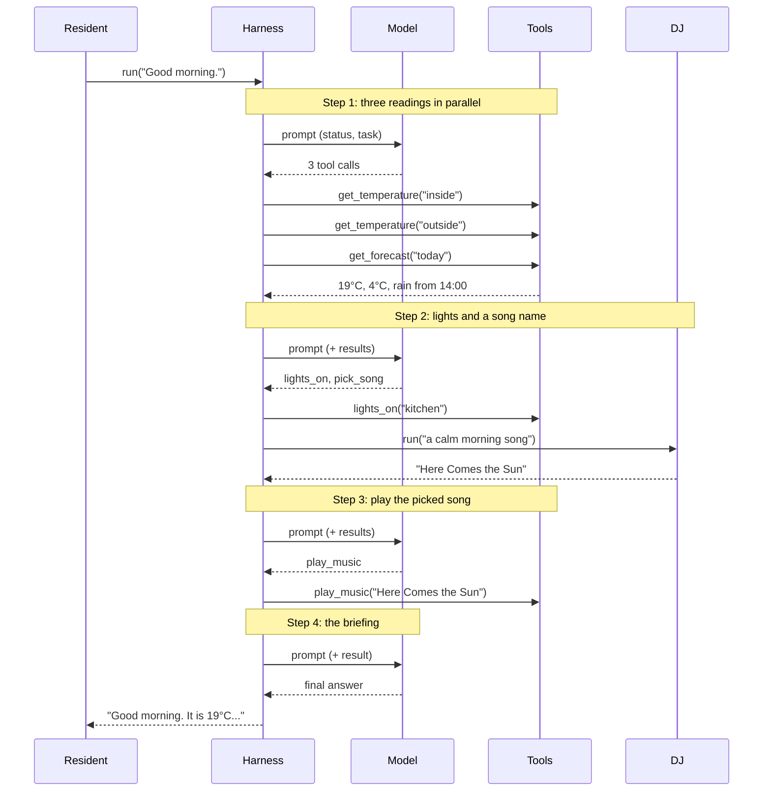

*Graph 12: The morning routine, in four steps.*

The final answer:

```text
Good morning. It is 19°C inside and 4°C outside, and rain is expected from 14:00, so take an umbrella. The kitchen lights are on and "Here Comes the Sun" is playing.
```

### Building other agents from the same blocks

Each change below touches one component and leaves the rest of the assistant as it is:

- Replace the model: move the assistant from a hosted API to a model on a home server, so no request leaves the home.
- Remove tools: without `play_music`, `stop_music` and `pick_song`, the assistant controls only the lights and reports the weather.
- Add a tool: `set_thermostat(temperature)` lets the assistant heat the home, behind a guard rule that clamps the temperature to between 16°C and 24°C.
- Replace the guard rules: a home with a sleeping baby adds a rule that denies `lights_on("bedroom")` after 20:00.
- Compose further: the home assistant itself becomes a tool of a personal assistant agent, next to a calendar agent and an email agent.

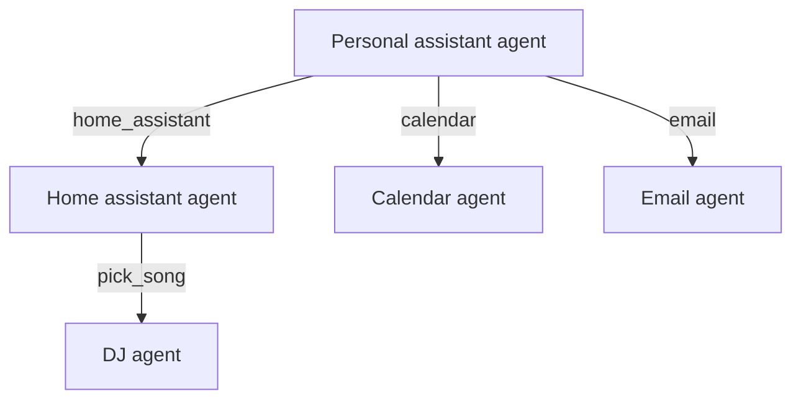

*Graph 13: The home assistant reused as a tool of a larger agent.*

## 10. Principles

- Each component exposes a narrow interface and depends only on the shared data and on the interfaces of other components.
- Each component changes for one reason: the model when models or where they run change, the loop when agent behaviour changes and tools when capabilities change.
- Components exchange data only, and the state of a run is data.
- Every component can be replaced and tested on its own, against fakes of the components around it.

## 11. Not covered here

These topics are developed in separate documents: scheduling and rate limits shared by many agents, a model registry and routing between models, persistence of runs, messages that arrive while a run is going, cancellation, and starting and closing components that hold connections or processes.
